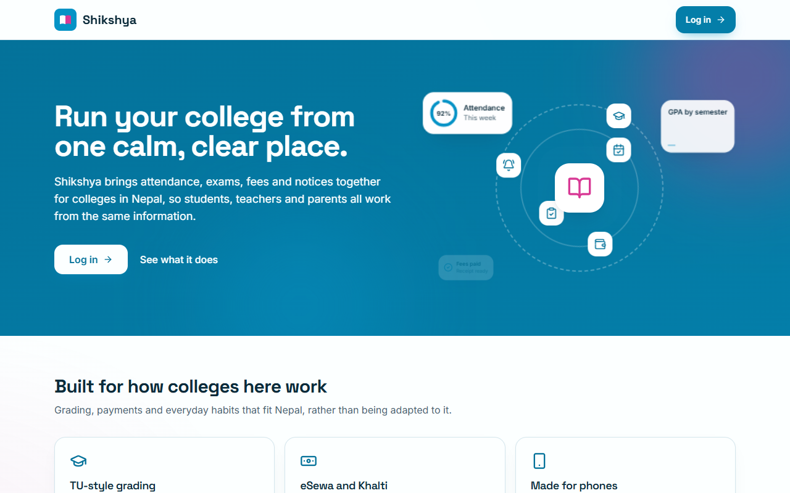
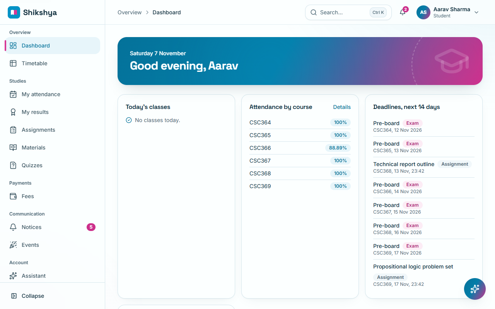
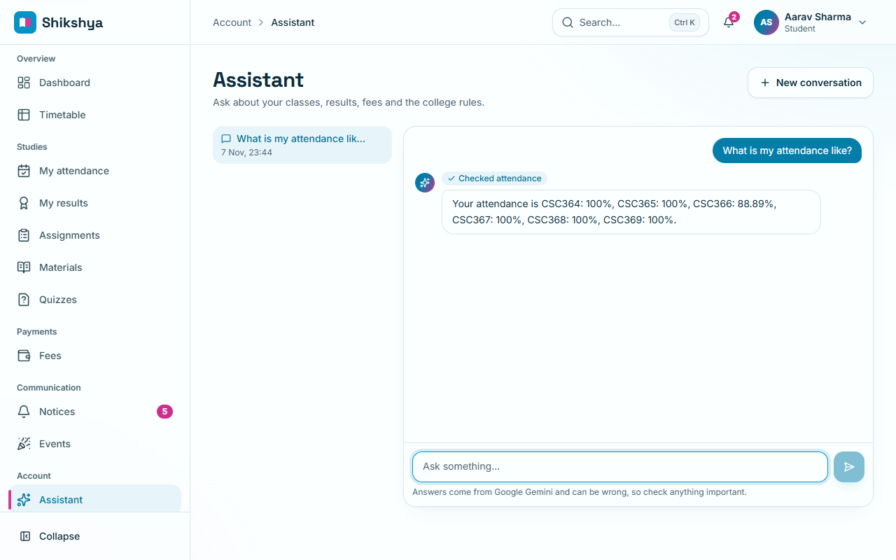
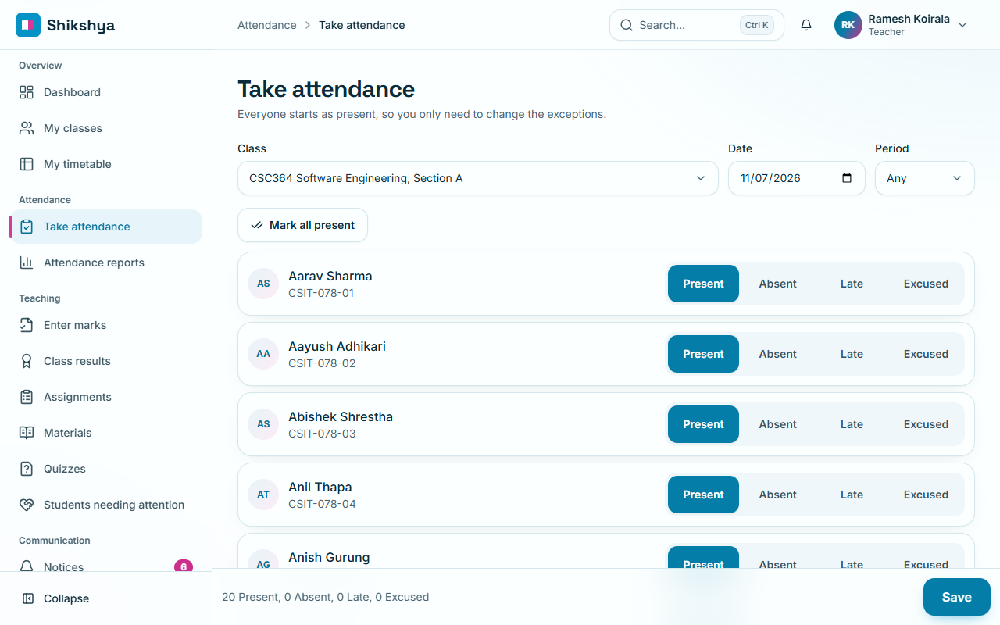
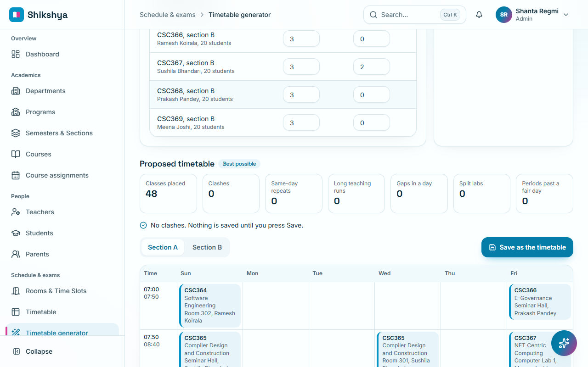
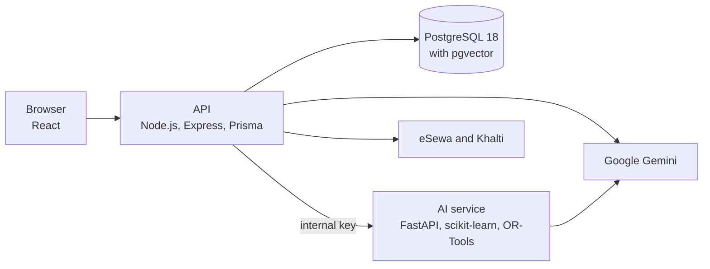

# Shikshya

A college management system for Nepal, with TU-style GPA grading, eSewa and Khalti payments, and AI features that keep people in charge. Students, teachers, parents and staff each work from the same information, and each sees only what they should.

It is also a BSc. CSIT academic project, so it is built to be easy to explain. Start with [docs/architecture.md](docs/architecture.md).



|                                                                  |                                                                                             |
| ---------------------------------------------------------------- | ------------------------------------------------------------------------------------------- |
|  |  |
|     |                   |

## What it does

- **Academics:** programs, semesters, sections, courses, timetables and clash detection.
- **Attendance:** taken in seconds on a phone, with automatic warnings below 75%.
- **Exams:** marks entry, GPA and CGPA on the TU scale, marksheets, transcripts and ID cards as PDFs.
- **Coursework:** assignments, submissions, class materials and quizzes.
- **Fees:** invoices, fines, eSewa and Khalti, manual payments, receipts and reports.
- **Communication:** targeted notices, events, and live and email notifications.
- **AI:** an assistant that answers from each person's own records, early warnings about struggling students, quiz drafts from a teacher's notes, and a timetable solver. See [AI features](#ai-features).

Seven roles: super admin, admin, teacher, student, parent, accountant and librarian. A test makes a real request for [every route as every role](docs/permissions.md).

## How it fits together



```
apps/web         React + Vite frontend
apps/web/e2e     Browser tests with Playwright
apps/api         Express + Prisma API
apps/ai          FastAPI service: at-risk model, quiz generation, timetable solver
packages/shared  Zod schemas, types and calculations, shared by web and api
load             Load test with k6
docs             Everything below
```

## Documentation

| Read this                                    | For                                                                                                                                                                                     |
| -------------------------------------------- | --------------------------------------------------------------------------------------------------------------------------------------------------------------------------------------- |
| [docs/user-manual.md](docs/user-manual.md)   | How to use it, for each role, with pictures                                                                                                                                             |
| [docs/architecture.md](docs/architecture.md) | The system, and how login, payment and the assistant work                                                                                                                               |
| [docs/diagrams.md](docs/diagrams.md)         | Report diagrams: use case, DFD, class, activity and Gantt                                                                                                                               |
| [docs/database.md](docs/database.md)         | Every table, with ER diagrams                                                                                                                                                           |
| [docs/api.md](docs/api.md)                   | Every API route                                                                                                                                                                         |
| [docs/permissions.md](docs/permissions.md)   | Who may call each route                                                                                                                                                                 |
| [docs/security.md](docs/security.md)         | What protects the system                                                                                                                                                                |
| [docs/test-cases.md](docs/test-cases.md)     | Test cases in report format                                                                                                                                                             |
| [docs/performance.md](docs/performance.md)   | Measurements and load tests                                                                                                                                                             |
| [docs/deployment.md](docs/deployment.md)     | Putting it online                                                                                                                                                                       |
| [docs/backup.md](docs/backup.md)             | Backing up and restoring                                                                                                                                                                |
| [docs/algorithms](docs/algorithms)           | [GPA](docs/algorithms/gpa.md), [the risk model](docs/algorithms/risk-model.md), [the timetable solver](docs/algorithms/timetable.md) and [college-rules search](docs/algorithms/rag.md) |
| [docs/ai-demo.md](docs/ai-demo.md)           | A walk-through of the AI features, for a demo                                                                                                                                           |
| [docs/phases](docs/phases)                   | The original specification, in five phases                                                                                                                                              |

## Run it locally

You need Node.js 20 or newer, [pnpm](https://pnpm.io/installation), Python 3.11 for the AI features, and a free [Neon](https://neon.com) database. Docker is optional.

1. Install dependencies:
   ```bash
   pnpm install
   ```
2. Create the API's settings file. All the app's settings live here:
   ```bash
   cp apps/api/.env.example apps/api/.env
   ```
3. Set up the database. Create a Neon project with Postgres 18 in Singapore, and copy its **direct** connection string, the one with no `-pooler` in the host. Set it as `DATABASE_URL` in `apps/api/.env`, with `&connect_timeout=15&connection_limit=8&pool_timeout=30` on the end.

   To work offline instead, use `pnpm db:up` (Docker, with pgvector) or `pnpm db:local` (no Docker and no pgvector, so college-rules search uses keywords), and keep the default `DATABASE_URL`.

4. Create the tables:
   ```bash
   pnpm --filter @shikshya/api exec prisma migrate deploy
   ```
5. Load the demo data. This replaces everything in the database:
   ```bash
   pnpm db:seed
   ```
6. Set up the AI service, once:
   ```bash
   cd apps/ai
   py -3.11 -m venv .venv        # on macOS/Linux: python3.11 -m venv .venv
   .venv/Scripts/activate        # on macOS/Linux: source .venv/bin/activate
   pip install -r requirements.txt -r requirements-dev.txt
   cd ../..
   ```
7. Start the web app, API and AI service together:
   ```bash
   pnpm dev
   ```
8. Open <http://localhost:5173> and log in with an account below.

### Demo accounts

Every account uses the password `Shikshya@123`.

| Role                        | Email                      |
| --------------------------- | -------------------------- |
| Super admin                 | `superadmin@shikshya.test` |
| Admin                       | `admin@shikshya.test`      |
| Accountant                  | `accountant@shikshya.test` |
| Teacher (1 to 4)            | `teacher1@shikshya.test`   |
| Student (01 to 40)          | `student01@shikshya.test`  |
| Student with low attendance | `student03@shikshya.test`  |
| Parent of two children      | `parent1@shikshya.test`    |

### Importing students

Admins can import students from a CSV file under **Students → Import CSV**, which also offers a template. Every row is checked first, and if any row has a problem nothing is imported. The program, semester and section must already exist in the current academic year.

## Commands

| Command                 | What it does                                                                |
| ----------------------- | --------------------------------------------------------------------------- |
| `pnpm dev`              | Runs the web app (5173), API (4000) and AI service (8000)                   |
| `pnpm test`             | Runs all tests. Starts its own throwaway Postgres                           |
| `pnpm coverage`         | The same, with coverage reports                                             |
| `pnpm e2e`              | Browser journeys on the production build, with their own ports and database |
| `pnpm lint`             | ESLint and the Prettier check                                               |
| `pnpm format`           | Formats the code with Prettier                                              |
| `pnpm typecheck`        | Type-checks every workspace                                                 |
| `pnpm build`            | Production builds                                                           |
| `pnpm db:migrate`       | Applies database migrations, creating new ones as needed                    |
| `pnpm db:seed`          | Replaces the database with demo data (refused in production)                |
| `pnpm db:backup`        | Saves a copy of the database to `backups/`                                  |
| `pnpm docs:generate`    | Rewrites `docs/api.md` and `docs/database.md` from the code                 |
| `pnpm docs:screenshots` | Retakes the pictures in the user manual                                     |
| `pnpm khalti:check`     | Shows what Khalti says to a small test payment                              |
| `pnpm ai:check`         | Tries Gemini and the AI service for real, using a little quota              |

In `apps/ai`, with its `.venv` active: `pytest`, `pytest --cov=app --cov=timetable --cov=ml`, `ruff check .`, `pip-audit -r requirements.txt`, and `python -m ml.train` to retrain the at-risk model.

## Settings

Settings for the API are in `apps/api/.env`, and each one is explained in [apps/api/.env.example](apps/api/.env.example). The ones you are most likely to need:

| Setting                                   | Needed for                                            | Without it                                                          |
| ----------------------------------------- | ----------------------------------------------------- | ------------------------------------------------------------------- |
| `DATABASE_URL`                            | Everything                                            | The API will not start                                              |
| `JWT_ACCESS_SECRET`, `JWT_REFRESH_SECRET` | Logging in                                            | The API will not start                                              |
| `WEB_ORIGIN`                              | The browser reaching the API                          | Defaults to `http://localhost:5173`                                 |
| `INTERNAL_KEY`                            | The API talking to the AI service                     | At-risk, quiz and timetable features say the service is not running |
| `GEMINI_API_KEY`                          | The assistant, quizzes and meaning-based rules search | Those features say they are not set up                              |
| `KHALTI_SECRET_KEY`                       | Paying with Khalti                                    | The payment dialog shows Khalti as not available                    |
| `SMTP_HOST` and others                    | Sending real email                                    | Emails are logged instead                                           |
| `STORAGE_DRIVER`, `S3_*`                  | Keeping uploads in cloud storage                      | Files are kept on this computer's disk                              |

In production, the API refuses to start if a setting is missing or unsafe, and lists them all. See [docs/deployment.md](docs/deployment.md).

The web app works with no settings in development, because Vite forwards `/api` to the API. See [apps/web/.env.example](apps/web/.env.example).

## Getting around

- **Search:** press `Ctrl K` (`Cmd K` on a Mac) or use the search box at the top to reach any page your role can open. Type, then use the arrow keys and Enter.
- **Sidebar:** **Collapse**, at its foot, shrinks it to icons. This device remembers the choice.
- **Phones:** a bar along the bottom holds your four main places, and **More** opens everything else.
- **Keyboard:** the first Tab on any page offers a link that skips to the content. Tabs and attendance choices move with the arrow keys. After a page change, focus moves to the new page and screen readers announce it.
- **Less motion:** the app follows your device's "reduce motion" setting. Animations stop and nothing else changes.
- **Charts:** every chart has **View as table** underneath, for exact numbers.

## AI features

Four features, explained for a demo in [docs/ai-demo.md](docs/ai-demo.md):

- **Shikshya Assistant:** answers from live data and the college rules. It fetches everything through the same services and permission checks as the normal API, and no tool takes a student id, so a prompt cannot reach someone else's records.
- **Students needing attention:** a model flags students who may fail, with reasons a teacher can act on. Students never see a label. It is trained on synthetic data, so read its [model card](apps/ai/ml/model_card.md) before relying on it.
- **Quiz generator:** drafts questions from a teacher's notes. Nothing reaches students until the teacher has approved every question.
- **Timetable generator:** a constraint solver proposes a week with no clashes, for an admin to adjust and save. [How it works](docs/algorithms/timetable.md).

### Setting up Gemini

Create a key at [AI Studio](https://aistudio.google.com), put it in `apps/api/.env` as `GEMINI_API_KEY`, restart `pnpm dev`, and run `pnpm ai:check`. The at-risk and timetable features work without it.

**Use the free tier with the fake demo data only.** Google may use free-tier prompts and replies to improve its products, human reviewers may read them, and its [terms](https://aistudio.google.com/docs/terms) forbid sending personal data. Real student data needs billing enabled at least. The same terms bar apps likely to be used by under-18s on any tier, so a school with younger students would need another provider. `apps/api/src/lib/llm.ts` is the only file that would change.

Every AI call is logged in the `AiCallLog` table, with the user, feature, tokens and time taken, but no prompts or replies.

## Attendance rules

- A student's percentage is `(present + late) / (present + late + absent)`. Excused classes are left out entirely.
- Below 75% is flagged throughout the system. Exactly 75% is not.
- Teachers may edit a session for 48 hours after taking it. Admins may edit at any time. Every create and edit is written to the audit log.

## Grading

The grade table lives in the database (`GradeScale`) so a college can adjust it. The seed uses the table published by [TU's Central Department of CS & IT](https://cdcsit.tu.edu.np/pages/bs-2733):

| Percent   | Grade | Grade point |
| --------- | ----- | ----------- |
| 90 to 100 | A     | 4.0         |
| 80 to <90 | A-    | 3.7         |
| 70 to <80 | B+    | 3.3         |
| 60 to <70 | B     | 3.0         |
| 50 to <60 | B-    | 2.7         |
| 40 to <50 | C     | 2.3         |
| below 40  | F     | 0           |

- A course's percentage is its total marks over its total full marks, across the semester's published exams. Reaching the combined pass marks is also required, otherwise the course is an F.
- An absent student scores zero for that paper.
- GPA is the sum of (grade point x credit) divided by the sum of credits. CGPA does the same across published semesters. Both round to 2 decimals.
- Publishing an exam locks its marks and calculates results in one transaction, and is refused while any marks are missing. An admin can unlock it, which withdraws that exam from students' results until it is published again. Both actions are logged.

## Files

Uploads are limited to 10 MB each and to pdf, docx, pptx, zip, jpg and png, checked by each file's contents as well as its name. They are stored under random names behind a `StorageService` interface: on this computer's disk by default, or in S3-compatible storage with `STORAGE_DRIVER=s3`. Every download goes through the API, which applies the same access rules as the record the file belongs to.

## Fees and payments

All money is stored as integer paisa. Staff type rupees, and the API converts them.

- **Invoices** are generated per semester from its fee structure. Generating twice creates no duplicates.
- **Fines** are recalculated from the due date by a daily job, so running it twice changes nothing.
- **Online payments** go through one `PaymentGateway` interface, with eSewa and Khalti behind it. A redirect back from a gateway is never believed: the API asks the gateway directly, checks the amount matches exactly, and only then credits the invoice. Duplicate callbacks do nothing. A payment left unconfirmed is rechecked every 15 minutes and given up on after a day.
- **Khalti** needs a key in `KHALTI_SECRET_KEY`. Until then, the payment dialog shows it as not available.

### Checking payments in the sandbox

Automated tests cover the payment logic against mocked gateway responses. A real sandbox payment has to be done by hand, because it means logging in on the gateway's own site:

1. Start the app, log in as `student02@shikshya.test` and open **Fees**.
2. **eSewa:** choose **Pay now → Pay with eSewa**, then log in on eSewa's test page with ID `9711111111`, password `Nepal@123`, MPIN `1122` and token `123456`.
3. **Khalti:** first create a merchant account at <https://test-admin.khalti.com> (the login OTP is `987654`), put its `live_secret_key` in `apps/api/.env` as `KHALTI_SECRET_KEY`, and restart. Run `pnpm khalti:check` to confirm Khalti accepts it. Then, still as `student02@shikshya.test`, pay the **Rs. 150 library fine**, choosing **Pay with Khalti**, then **Khalti Wallet**, and using ID `9800000001`, MPIN `1111` and OTP `987654`.
4. You should return to a "Payment successful" page where the receipt downloads, and the invoice should now show as paid.

Khalti's test mode only accepts small amounts, about [Rs. 10 to Rs. 200](https://docs.khalti.com/gotchas/), which is why the Rs. 51,500 tuition invoices cannot be paid with it in the sandbox. If Khalti refuses a payment, the app shows Khalti's own reason. `pnpm khalti:check` prints what Khalti says to a small test payment, which tells a problem with your key from one on Khalti's side.

Khalti's test wallets, `9800000000` to `9800000005`, are shared by everyone using the sandbox, so one can be locked by other people's wrong attempts ("Khalti MPIN has been locked"). If that happens, use another. On 7 November 2026, `9800000000` was locked and `9800000001` worked.

These test values come from [eSewa's](https://developer.esewa.com.np/pages/Epay) and [Khalti's](https://docs.khalti.com/khalti-epayment/) developer docs. For production, set your own keys and URLs in `apps/api/.env`.

## Notifications

Notifications appear in the app in real time and by email, and each person can turn types off under **Notification settings**. With no `SMTP_HOST` set, emails are logged rather than sent. To see real ones locally, run [Mailpit](https://mailpit.axllent.org/) and set `SMTP_HOST=localhost` and `SMTP_PORT=1025`. Scheduled jobs run inside the API process.

## Who can see what

Each API route declares which roles may call it, and services apply row-level rules on top: a student sees only their own records, a parent only their linked children, and a teacher only the sections they teach. Hiding a page in the web app is only a convenience. The API is what enforces access. [docs/permissions.md](docs/permissions.md) has the full table, which a test checks against the real API.

## Temporary passwords

Accounts created by an admin get a temporary password, shown to the admin once, and must choose a new one at first login.
