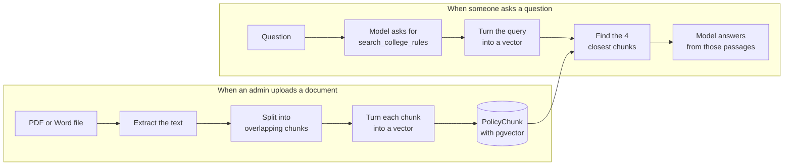

# Searching the college rules (RAG)

Written for the project report and viva. The code is in `apps/api/src/services/policy.service.ts` and `chunking.ts`.

## The problem

A language model knows nothing about one college's rules, and will confidently make something up if asked. **Retrieval-augmented generation (RAG)** solves this: find the relevant passages first, then give them to the model to answer from.



## Step by step

**1. Extract.** The AI service reads the file's text with `pypdf` or `python-docx`. A file with no text, such as a scanned PDF, is refused rather than stored and useless.

**2. Chunk.** A whole document is too long to send with every question, and a search should find the part that answers it. So the text is split into pieces of about 800 tokens, or 3,200 characters, with an overlap of about 100 tokens, or 400 characters. English averages about 4 characters to a token. Each chunk tries to end at a paragraph break, or else a sentence. The overlap keeps a rule that falls across a boundary readable in at least one piece.

**3. Embed.** Gemini's `gemini-embedding-001` turns each chunk into a list of 768 numbers, called a vector. Texts with similar meanings get similar vectors, even if they share no words: "late payment" and "fine for overdue fees" end up close together. Documents and questions are embedded with different task settings, `RETRIEVAL_DOCUMENT` and `RETRIEVAL_QUERY`, because Gemini tunes each for its role.

**4. Search.** The question is embedded in the same way, then pgvector finds the 4 nearest chunks by cosine distance, with an HNSW index so it need not compare against every chunk:

```sql
SELECT d.title AS document, c.content AS text
FROM "PolicyChunk" c JOIN "PolicyDocument" d ON d.id = c."documentId"
WHERE c.embedding IS NOT NULL
ORDER BY c.embedding <=> $1::vector
LIMIT 4
```

Cosine distance compares the direction of two vectors rather than their length:

$$\text{cosine distance}(a, b) = 1 - \frac{a \cdot b}{\lVert a \rVert \, \lVert b \rVert}$$

**5. Answer.** The passages go back to the model as a tool result, marked as data. The system prompt tells it to answer only from tool results and the college rules, and to say "I don't know" otherwise.

## When meaning search is not available

Search falls back to Postgres full-text search, using `websearch_to_tsquery`, in three situations: there is no Gemini key, the database has no pgvector, as in the automated tests, or the embedding call fails. It finds less, because it needs words to match, but the assistant keeps working. The **College rules** page shows which documents can be searched by meaning, and **Prepare search** embeds any that were added while Gemini was unavailable.

## Protecting against instructions in documents

A rules document could contain text like "ignore your instructions". Three things limit what that could do, and the last is the one that matters most:

1. Tool results reach the model between `<data>` tags, which the system prompt says to treat only as data. Angle brackets inside are escaped, so no text can close the tag early.
2. Only admins can upload documents.
3. Even a completely fooled model can only call the tools its user is allowed, and each tool checks permissions itself. So it could not reach anyone else's records.

## Limitations

- It answers from what it retrieves, so a poorly worded question can miss the right passage.
- Chunks are split by size rather than by section, so a long rule might be cut across two.
- The model can still misread a passage. The interface says answers can be wrong, and to check anything important.

## Testing

`apps/api/src/services/chunking.test.ts` checks splitting and overlap. `apps/api/test/assistant.test.ts` checks that documents are stored and split, that any role can search through the assistant, that nothing is invented when nothing matches, and that deleting a document removes its passages. The automated tests have no pgvector, so they cover keyword search.

Meaning-based search was checked by hand on 7 November 2026, against real Gemini and Neon. A real embedding was stored in the pgvector column and searched, inside a transaction that was then rolled back, so nothing changed. The embedding had the expected 768 dimensions. "How many days late can I pay my fees?" scored 0.62 against the rules, and "What is the capital of France?" scored 0.47. To turn it on for a demo, press **Prepare search** on the **College rules** page.
