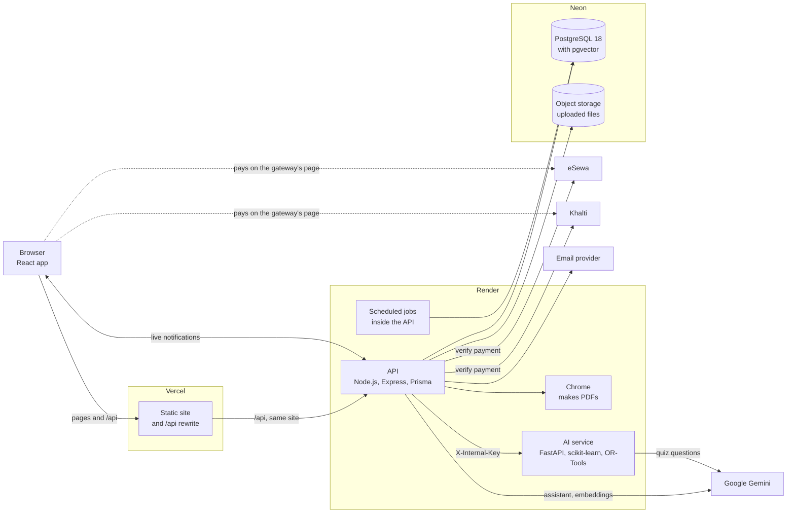
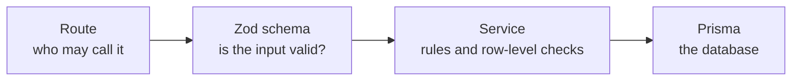
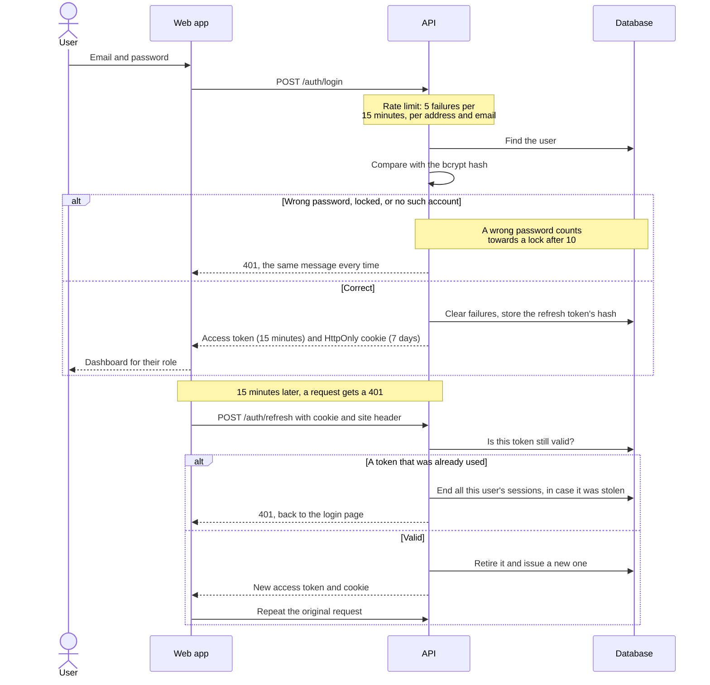
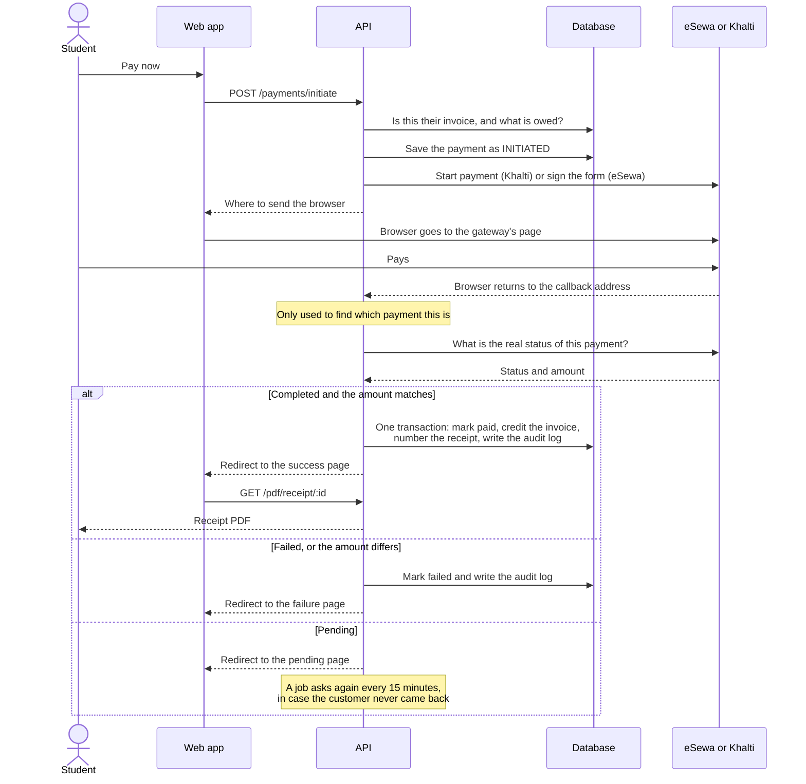
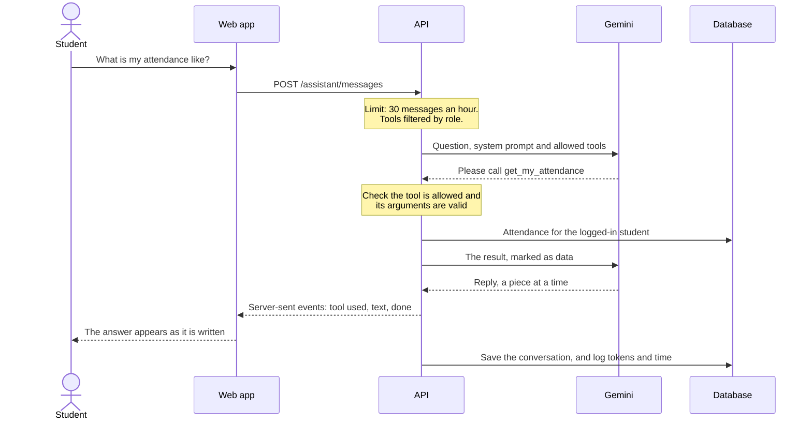

# Architecture

How the parts of Shikshya fit together, and what happens during the three requests that matter most: logging in, paying a fee, and asking the assistant a question.

## The system

| Part                               | Technology                                           | Its job                                                                                                                                                                                  |
| ---------------------------------- | ---------------------------------------------------- | ---------------------------------------------------------------------------------------------------------------------------------------------------------------------------------------- |
| Web app (`apps/web`)               | React 18, Vite, TypeScript, Tailwind, TanStack Query | Everything people see. It holds no rules of its own: hiding a page is a convenience, and the API enforces access.                                                                        |
| API (`apps/api`)                   | Node.js 20, Express 5, Prisma, Zod                   | All business rules, permissions and data access.                                                                                                                                         |
| AI service (`apps/ai`)             | Python 3.11, FastAPI, scikit-learn, OR-Tools         | The work that suits Python: the at-risk model, the timetable solver, quiz generation and reading PDFs. It never touches the database, and refuses any request without the shared secret. |
| Shared package (`packages/shared`) | TypeScript, Zod                                      | Validation rules, types and calculations used by both web and API, so they cannot disagree.                                                                                              |
| Database                           | PostgreSQL 18 with pgvector, on Neon                 | All records, and the college rules' embeddings.                                                                                                                                          |

### How the code is organised

Each API request goes through the same layers, which keeps controllers thin and makes rules easy to find:

A role check in the route is not enough on its own: a student may call `/students/:id/results`, but only with their own id. So `services/scope.ts` holds the row-level rules, and services call them. See [permissions.md](permissions.md) for the full table, which a test checks against the real API.

### Why two languages?

The solver and the machine learning libraries are Python's strength, and the rest of the project is TypeScript. Keeping the Python behind one small internal API means each side can be tested and explained alone. If the AI service is down, everything except its own features keeps working, and those features say so plainly.

## Request flow: logging in

Access tokens are short-lived and kept only in memory, so a script injected into a page has little to steal, and a stolen token soon expires. The refresh token lives in a cookie that scripts cannot read.

## Request flow: paying a fee

The most important rule is that a redirect from a gateway is never believed. Anyone could type that address into a browser. Only the gateway's own answer to the API's question counts, and the amount must match exactly.

Two callbacks arriving at once are safe: marking the payment as paid only succeeds for whichever gets there first, so the invoice is credited once.

## Request flow: asking the assistant

The model never chooses whose data it sees. It can only ask for tools from a list filtered by role, no tool takes a student id, and each tool works out the student from who is logged in, then calls the same service and permission check as the normal API. So a clever prompt has nothing to exploit.

After 5 rounds of tools, the model must answer with what it has, so a confused model cannot loop forever. See [security.md](security.md) for how text in tool results is kept from acting as instructions.

## Background jobs

These run inside the API process with `node-cron`, in Nepal time.

| When             | Job                                           |
| ---------------- | --------------------------------------------- |
| Every 5 minutes  | Send notices scheduled for now                |
| Every 15 minutes | Ask gateways about payments still unconfirmed |
| Every hour       | Remind students about assignments due soon    |
| 00:10 daily      | Mark overdue invoices and recalculate fines   |
| 01:30 daily      | Recalculate students needing attention        |

On a host that sleeps when idle, such as Render's free plan, these only run while the API is awake. Each job works out what is due from the data rather than counting on having run recently, so a late run catches up.

## Where to read more

- [database.md](database.md): every table, with diagrams
- [api.md](api.md): every route
- [permissions.md](permissions.md): who may call what
- [security.md](security.md): what protects the system
- [performance.md](performance.md): measurements and load tests
- [deployment.md](deployment.md): putting it online
- [algorithms/](algorithms): GPA, the risk model, the timetable solver and college-rules search
