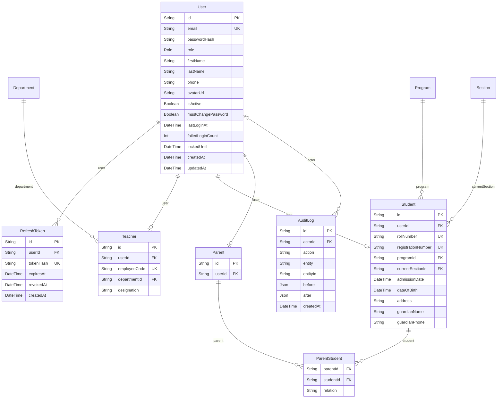
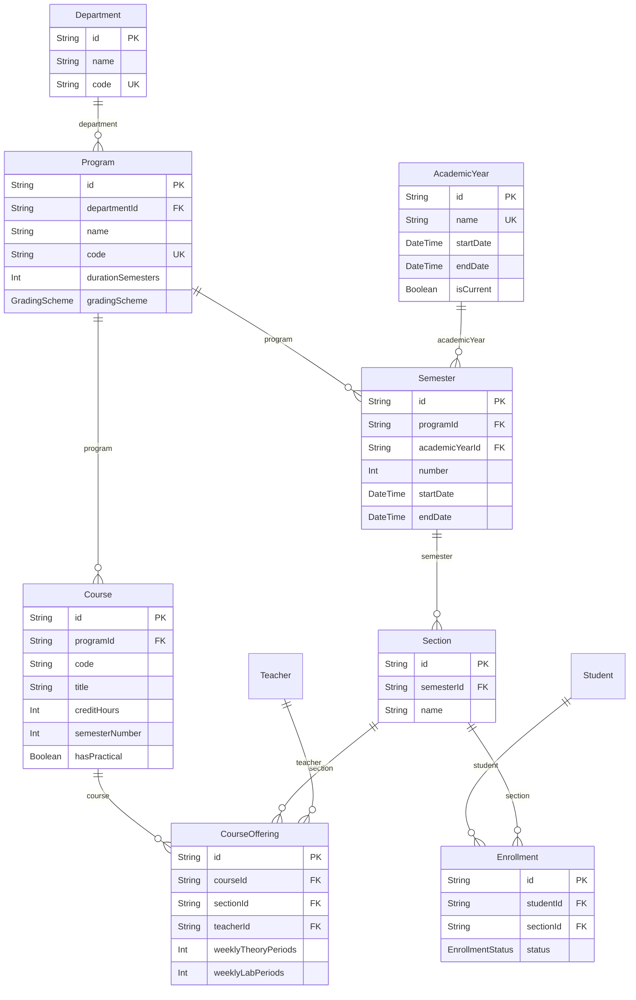
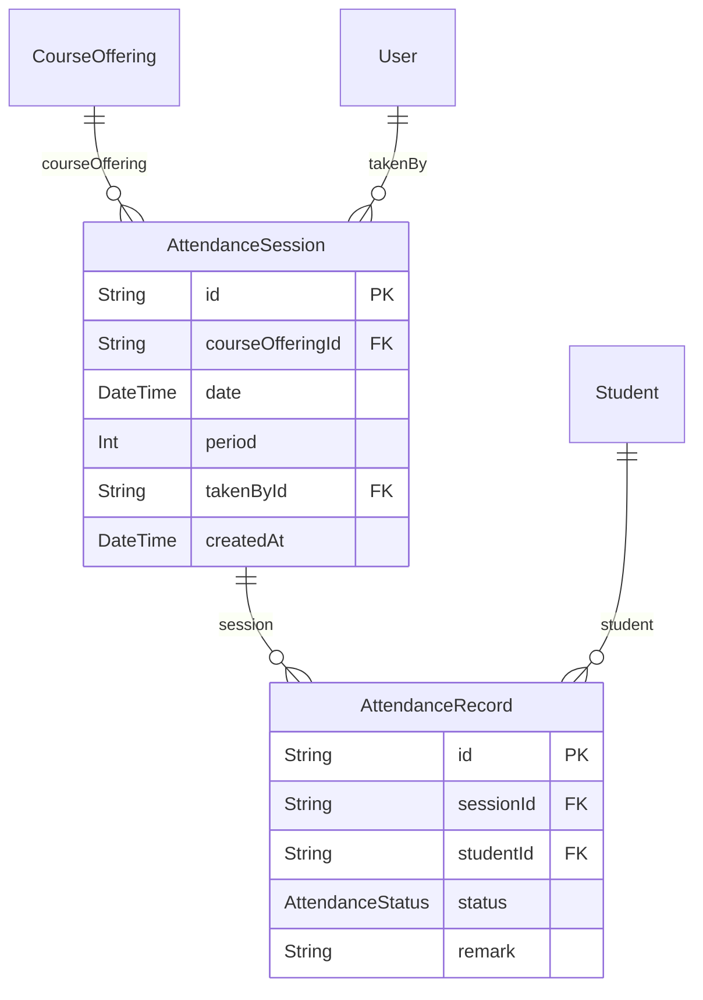
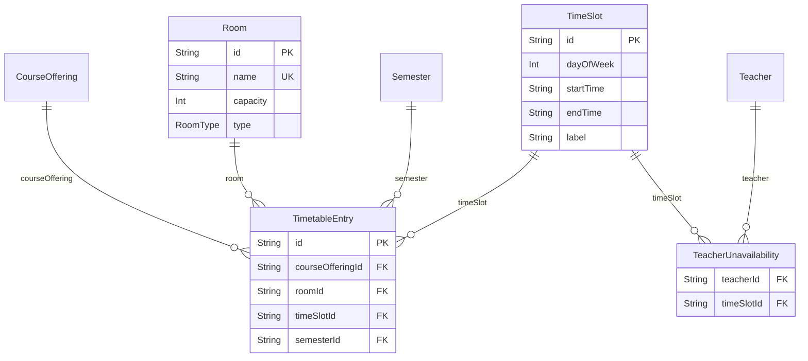
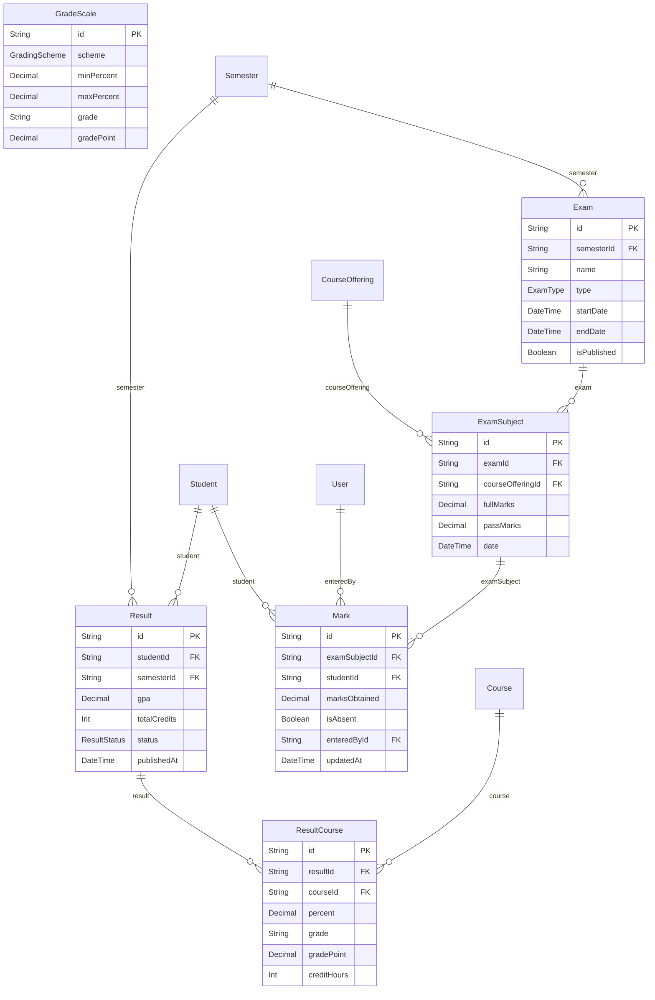
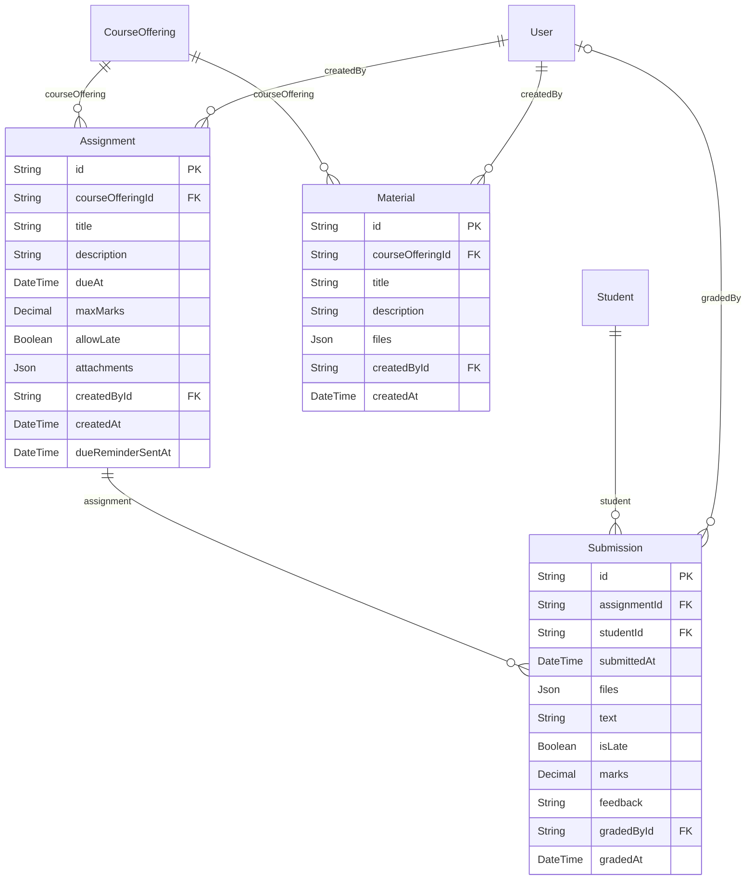
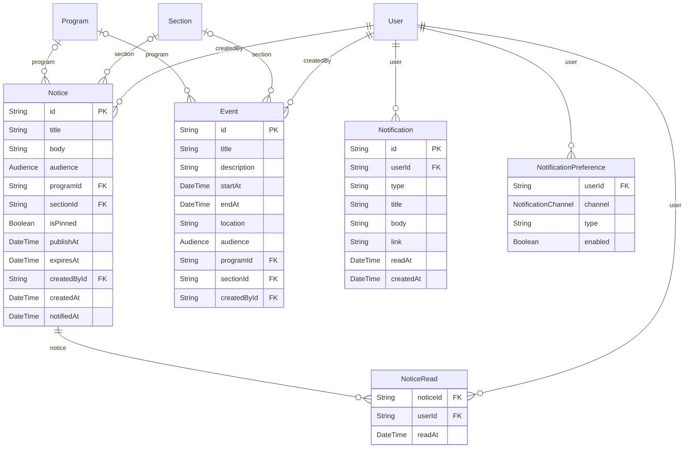
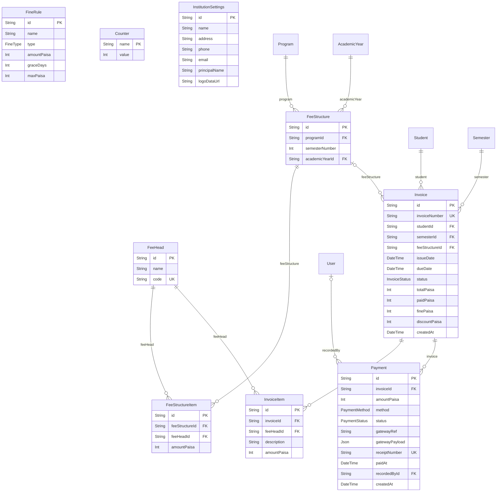
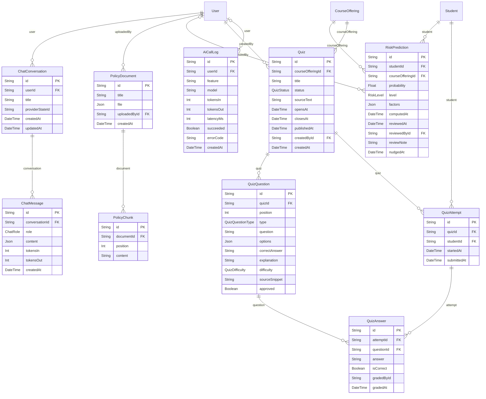

# Database

Generated from `apps/api/prisma/schema.prisma` by `pnpm docs:generate`. Do not edit by hand: `apps/api/test/docs.test.ts` fails if this differs from the schema.

54 tables in PostgreSQL 18, accessed through Prisma. Money is stored as whole paisa, and dates as UTC. A `FK` points to the table named in the lines below it.

`PolicyChunk` also has an `embedding vector(768)` column from pgvector, for searching the college rules by meaning. Prisma cannot describe that type, so it does not appear below, and migrations only add it where the extension is available. See [algorithms/rag.md](algorithms/rag.md).

## How the tables relate

Every table and relationship, without their columns. The sections after it show each area in detail.

```mermaid
erDiagram
  User ||--o{ RefreshToken : "user"
  Department ||--o{ Program : "department"
  Program ||--o{ Semester : "program"
  AcademicYear ||--o{ Semester : "academicYear"
  Semester ||--o{ Section : "semester"
  Program ||--o{ Course : "program"
  Course ||--o{ CourseOffering : "course"
  Section ||--o{ CourseOffering : "section"
  Teacher ||--o{ CourseOffering : "teacher"
  User ||--o| Teacher : "user"
  Department ||--o{ Teacher : "department"
  User ||--o| Student : "user"
  Program ||--o{ Student : "program"
  Section ||--o{ Student : "currentSection"
  User ||--o| Parent : "user"
  Parent ||--o{ ParentStudent : "parent"
  Student ||--o{ ParentStudent : "student"
  Student ||--o{ Enrollment : "student"
  Section ||--o{ Enrollment : "section"
  CourseOffering ||--o{ AttendanceSession : "courseOffering"
  User ||--o{ AttendanceSession : "takenBy"
  AttendanceSession ||--o{ AttendanceRecord : "session"
  Student ||--o{ AttendanceRecord : "student"
  User |o--o{ AuditLog : "actor"
  CourseOffering ||--o{ TimetableEntry : "courseOffering"
  Room ||--o{ TimetableEntry : "room"
  TimeSlot ||--o{ TimetableEntry : "timeSlot"
  Semester ||--o{ TimetableEntry : "semester"
  Semester ||--o{ Exam : "semester"
  Exam ||--o{ ExamSubject : "exam"
  CourseOffering ||--o{ ExamSubject : "courseOffering"
  ExamSubject ||--o{ Mark : "examSubject"
  Student ||--o{ Mark : "student"
  User ||--o{ Mark : "enteredBy"
  Student ||--o{ Result : "student"
  Semester ||--o{ Result : "semester"
  Result ||--o{ ResultCourse : "result"
  Course ||--o{ ResultCourse : "course"
  CourseOffering ||--o{ Assignment : "courseOffering"
  User ||--o{ Assignment : "createdBy"
  Assignment ||--o{ Submission : "assignment"
  Student ||--o{ Submission : "student"
  User |o--o{ Submission : "gradedBy"
  CourseOffering ||--o{ Material : "courseOffering"
  User ||--o{ Material : "createdBy"
  Program |o--o{ Notice : "program"
  Section |o--o{ Notice : "section"
  User ||--o{ Notice : "createdBy"
  Notice ||--o{ NoticeRead : "notice"
  User ||--o{ NoticeRead : "user"
  Program |o--o{ Event : "program"
  Section |o--o{ Event : "section"
  User ||--o{ Event : "createdBy"
  Program ||--o{ FeeStructure : "program"
  AcademicYear ||--o{ FeeStructure : "academicYear"
  FeeStructure ||--o{ FeeStructureItem : "feeStructure"
  FeeHead ||--o{ FeeStructureItem : "feeHead"
  Student ||--o{ Invoice : "student"
  Semester ||--o{ Invoice : "semester"
  FeeStructure |o--o{ Invoice : "feeStructure"
  Invoice ||--o{ InvoiceItem : "invoice"
  FeeHead ||--o{ InvoiceItem : "feeHead"
  Invoice ||--o{ Payment : "invoice"
  User |o--o{ Payment : "recordedBy"
  User ||--o{ Notification : "user"
  User ||--o{ NotificationPreference : "user"
  User ||--o{ ChatConversation : "user"
  ChatConversation ||--o{ ChatMessage : "conversation"
  User ||--o{ PolicyDocument : "uploadedBy"
  PolicyDocument ||--o{ PolicyChunk : "document"
  Student ||--o{ RiskPrediction : "student"
  CourseOffering ||--o{ RiskPrediction : "courseOffering"
  User |o--o{ RiskPrediction : "reviewedBy"
  CourseOffering ||--o{ Quiz : "courseOffering"
  User ||--o{ Quiz : "createdBy"
  Quiz ||--o{ QuizQuestion : "quiz"
  Quiz ||--o{ QuizAttempt : "quiz"
  Student ||--o{ QuizAttempt : "student"
  QuizAttempt ||--o{ QuizAnswer : "attempt"
  QuizQuestion ||--o{ QuizAnswer : "question"
  Teacher ||--o{ TeacherUnavailability : "teacher"
  TimeSlot ||--o{ TeacherUnavailability : "timeSlot"
  User |o--o{ AiCallLog : "user"
```

## People and access

## Academic structure

## Attendance

## Timetable

## Exams and results

## Assignments and materials

## Notices and notifications

## Fees and payments

## AI features

