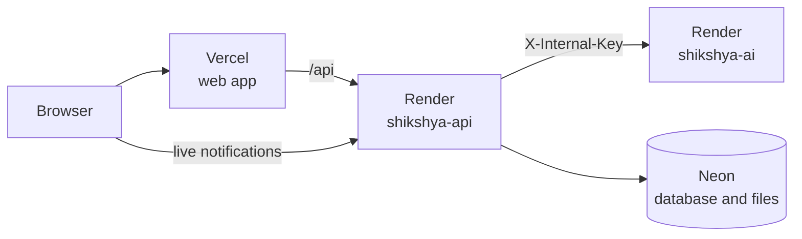

# Deployment

How to put Shikshya online for the viva, with free plans: **Vercel** for the web app, **Render** for the API and AI service, and **Neon** for the database and files. Everything here is a demo with fake data. See the [Gemini warning](security.md#ai) before using real student data.



## Why the web app forwards /api

The browser only ever talks to the Vercel address for the API, and Vercel forwards `/api` to Render. So the refresh cookie counts as the site's own, and `SameSite=Strict` can stay on. Live notifications are the exception: they connect to Render directly with the access token, using `VITE_SOCKET_URL`, because they use a WebSocket.

## Before you start

You need accounts on [Neon](https://neon.com), [Render](https://render.com) and [Vercel](https://vercel.com), and this repository on GitHub. Render and Vercel can both log in with GitHub.

**Keep these out of the repository and out of chat:** the database address, Gemini and Khalti keys, and storage keys. They go only into each host's settings.

## 1. Database

If you have been developing on Neon, it is already set up. For a clean demo, make a branch or a new project, then from your computer, with `DATABASE_URL` set to it:

```bash
pnpm --filter @shikshya/api exec prisma migrate deploy
pnpm db:seed
```

`pnpm db:seed` replaces everything in that database with the demo data, and takes about 4 minutes across the network. Then log in as an admin, open **College rules**, and press **Prepare search**, so the rules can be found by meaning.

Use the **direct** connection string, with no `-pooler` in the host, and `&connect_timeout=15&connection_limit=8&pool_timeout=30` on the end.

## 2. Storage for uploaded files

Render's free plan wipes its disk on every restart, so uploaded files need to live elsewhere. Any S3-compatible service works. These two have been considered:

- **[Neon Object Storage](https://neon.com/docs):** in the same Neon project, with no new account. Available in Singapore. Its credentials are made for one branch, using the Neon command line: see Neon's documentation for creating a bucket and getting them.
- **[Cloudflare R2](https://developers.cloudflare.com/r2/):** has a free allowance, but asks for a payment card.

Note the bucket name, the endpoint address, the region, and the access key and secret. Keep the bucket private, because the API sends all downloads itself.

For a demo, you can skip this: set `STORAGE_DRIVER` to `local` in step 3 and leave the `S3_` settings empty. Uploads then work until the service restarts, and the API warns about it in its log.

## 3. API and AI service on Render

1. In Render, choose **New → Blueprint**, and connect this repository. It reads `render.yaml`, which describes both services.
2. It asks for the values marked `sync: false`. Use these, adjusting the names if Render gives you different addresses:

   | Setting                                                                             | Value                                                                                                                                    |
   | ----------------------------------------------------------------------------------- | ---------------------------------------------------------------------------------------------------------------------------------------- |
   | `DATABASE_URL`                                                                      | From step 1                                                                                                                              |
   | `WEB_ORIGIN`                                                                        | Your Vercel address, for example `https://shikshya.vercel.app`. If you do not know it yet, put a placeholder and change it after step 4. |
   | `API_PUBLIC_URL`                                                                    | `https://shikshya-api.onrender.com`                                                                                                      |
   | `AI_SERVICE_URL`                                                                    | `https://shikshya-ai.onrender.com`                                                                                                       |
   | `GEMINI_API_KEY`                                                                    | Your key, on both services                                                                                                               |
   | `KHALTI_SECRET_KEY`                                                                 | Your sandbox key                                                                                                                         |
   | `S3_BUCKET`, `S3_REGION`, `S3_ENDPOINT`, `S3_ACCESS_KEY_ID`, `S3_SECRET_ACCESS_KEY` | From step 2                                                                                                                              |

   JWT secrets and `INTERNAL_KEY` are generated for you.

3. Deploy. The first build takes several minutes. Migrations run by themselves each time the API starts.
4. If the API refuses to start, its log lists every setting that is wrong.
5. Check <https://shikshya-api.onrender.com/health>. It should say `{"status":"ok","database":"ok"}`. The first request after a quiet spell can take up to a minute, while the service wakes.

The eSewa settings default to eSewa's published test values, so sandbox payments work without setting them.

## 4. Web app on Vercel

1. In Vercel, choose **Add New → Project**, and import this repository.
2. Set **Root Directory** to `apps/web`. It reads `apps/web/vercel.json` for the rest.
3. Add the setting `VITE_SOCKET_URL` with the value `https://shikshya-api.onrender.com`.
4. If Render gave your API a different address, change the `destination` in `apps/web/vercel.json` to match, and commit that.
5. Deploy, then go back to Render and make sure `WEB_ORIGIN` is exactly your Vercel address, with no slash on the end.

## 5. Automatic deployment

`.github/workflows/ci.yml` runs lint, tests and the browser journeys on every pull request, and deploys when `main` passes. It only works if that folder is in the repository, which it currently is not: `.gitignore` leaves `.github` out. To turn it on:

1. Remove `.github/` from `.gitignore`, then commit the folder.
2. In Render, copy each service's **Deploy Hook** from its settings. In Vercel, create one under **Settings → Git → Deploy Hooks**.
3. In GitHub, under **Settings → Secrets and variables → Actions**, add them as `RENDER_API_HOOK`, `RENDER_AI_HOOK` and `VERCEL_HOOK`.

Without this, deploy by hand from each dashboard after pushing. Render's `autoDeploy` is off in `render.yaml`, so that untested code does not go live by itself. Change it to `true` if you are not using the workflow.

## 6. Check it works

Log in with each demo account from the [README](../README.md#demo-accounts), and check:

- [ ] **Everyone:** the homepage shows when logged out, and logging in reaches the right dashboard.
- [ ] **Everyone:** reloading the page keeps you logged in, which shows the refresh cookie works.
- [ ] **Admin:** generate a timetable, and download a student's ID card as a PDF.
- [ ] **Teacher:** take attendance, and enter a mark. Upload a file as class material, and download it again after the service restarts.
- [ ] **Teacher:** generate a quiz from pasted notes.
- [ ] **Student:** ask the assistant about attendance, and how many days late fees can be paid.
- [ ] **Student:** a notification appears without reloading when someone posts a notice.
- [ ] **Student:** pay with eSewa's test account, and with Khalti's, as described in the [README](../README.md#checking-payments-in-the-sandbox). Then download the receipt.
- [ ] **Parent:** see both children's records.
- [ ] **Accountant:** the payment appears in the dashboard.

## Limits of the free plans

As [Render describes them](https://render.com/docs/free), on the date this was written. Check the current terms.

- **512 MB of memory and a tenth of a CPU.** PDFs, and especially the timetable solver, will be slower than on your computer. Chrome is the biggest risk for memory. If PDFs make the API restart, that plan is too small for them, and the next plan up is the fix.
- **Services sleep after 15 minutes without traffic,** and take up to a minute to wake. **Open the site a few minutes before your viva**, and try a page as each role. Scheduled jobs do not run while asleep, and they catch up when it wakes.
- **750 free hours a month per workspace,** shared by both services. Sleeping services do not use them.
- **No private network on free plans,** so the AI service has a public address. It refuses any request without `INTERNAL_KEY`. On a paid plan, it could be made private.
- **The API's jobs keep Neon awake while the API is awake,** which uses Neon's free compute hours. If they run short, check the usage page.

## If something goes wrong

| What you see                                          | What to check                                                                                                           |
| ----------------------------------------------------- | ----------------------------------------------------------------------------------------------------------------------- |
| API refuses to start                                  | Its log lists every wrong setting.                                                                                      |
| Login works, but a reload logs you out                | `WEB_ORIGIN` must match your Vercel address exactly, and the site must call `/api` through Vercel.                      |
| "This request did not come from the Shikshya website" | The same: `WEB_ORIGIN` does not match the address in the browser.                                                       |
| "The AI service is not running"                       | It may be asleep, so try again in a minute. Otherwise, check `AI_SERVICE_URL`, and that `INTERNAL_KEY` matches on both. |
| PDFs fail                                             | The API log. Out of memory shows as the service restarting.                                                             |
| Payment returns to a page that cannot be reached      | `API_PUBLIC_URL` must be the API's real address.                                                                        |
| Uploaded files disappear                              | `STORAGE_DRIVER` is `local`. See step 2.                                                                                |

## What has been tested

No hosted deployment has been done yet. There is no Docker on the computer this was written on, so the `Dockerfile`s themselves have not been built. Their main steps were run by hand instead: making the production folder with `pnpm deploy`, generating Prisma's client, running migrations, starting the compiled API in production mode, and making a PDF. All of those worked, on Windows. The CI workflow builds both images on Linux, once it is turned on.
