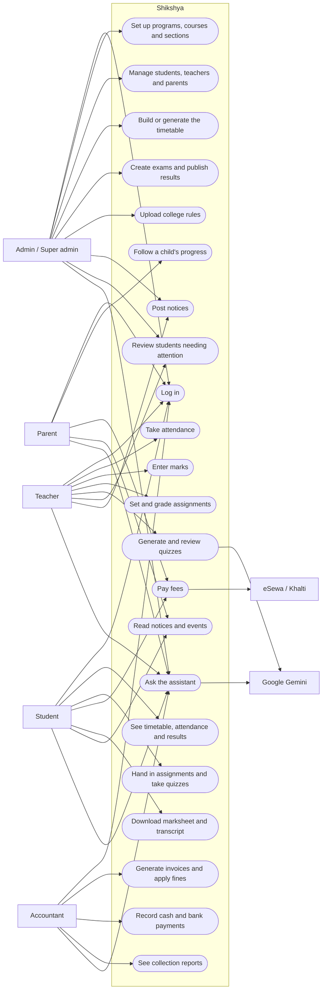
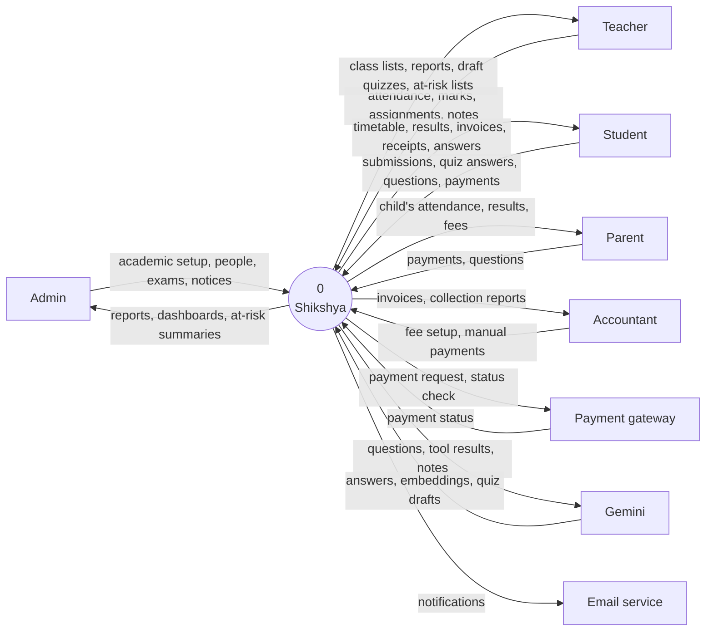
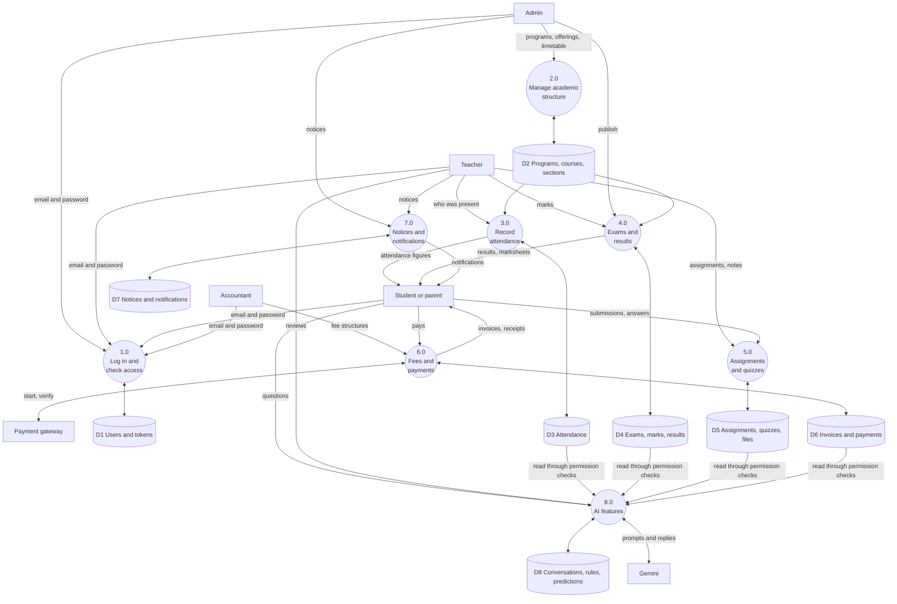
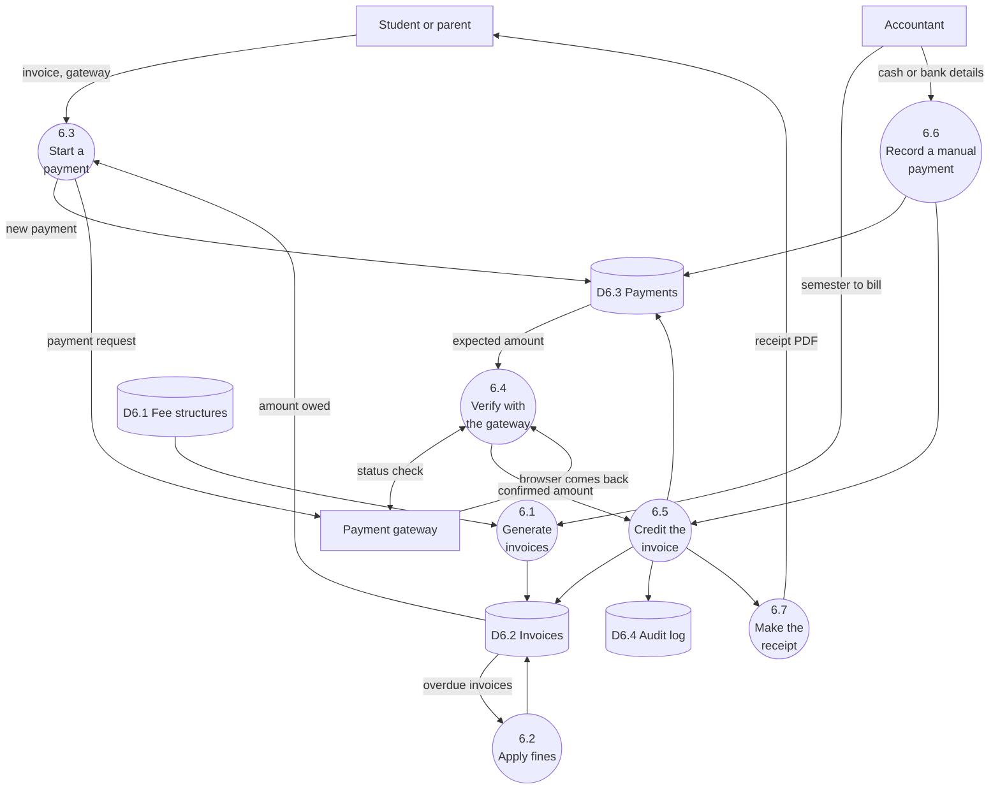
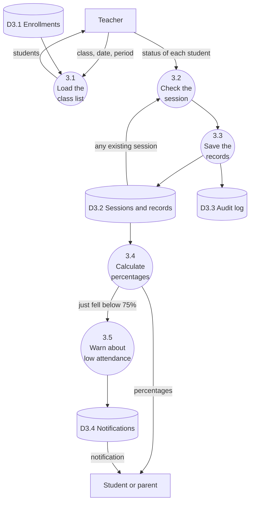
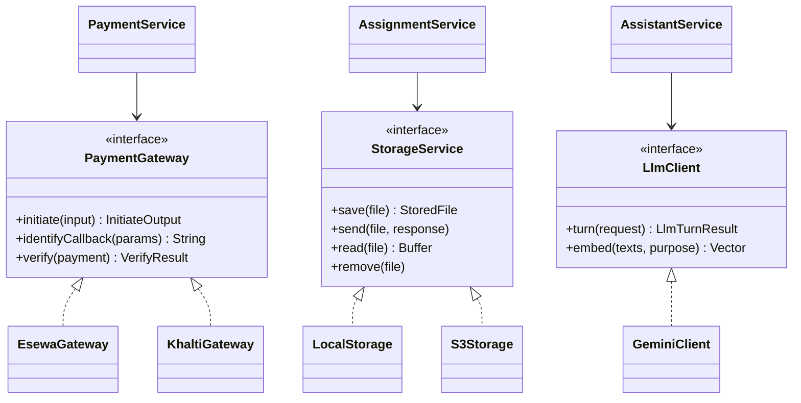
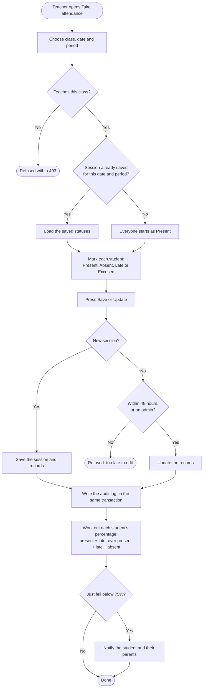
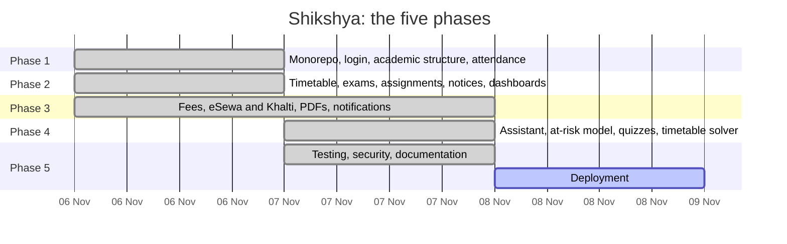

# Report diagrams

Diagrams for the project report, in Mermaid. GitHub draws them directly. To use one in Word, paste it into [mermaid.live](https://mermaid.live) and export it as an image.

The login, payment and assistant sequence diagrams are in [architecture.md](architecture.md), and the entity relationship diagrams are in [database.md](database.md).

## Use case diagram

Mermaid has no use case diagram of its own, so this one is drawn as a flowchart: people on the left, and what they can do in rounded boxes. Super admins can do everything admins can, and also change institution settings.

## Data flow diagram, level 0

The whole system as one process, with everyone it exchanges information with.

## Data flow diagram, level 1

The main processes inside the system, and the data they keep.

## Data flow diagram, level 2: payments

Process 6.0 in detail.

## Data flow diagram, level 2: attendance

Process 3.0 in detail.

## Class diagram

The main classes in the domain, with the most important fields. [database.md](database.md) has every table and column.

```mermaid
classDiagram
  class User {
    +String email
    +Role role
    +Boolean isActive
    +Int failedLoginCount
    +DateTime lockedUntil
  }
  class Student {
    +String rollNumber
    +Date admissionDate
  }
  class Teacher {
    +String employeeCode
    +String designation
  }
  class Parent
  class Program {
    +String code
    +Int durationSemesters
  }
  class Semester {
    +Int number
    +Date startDate
    +Date endDate
  }
  class Section {
    +String name
  }
  class Course {
    +String code
    +Int creditHours
  }
  class CourseOffering {
    +Int weeklyTheoryPeriods
    +Int weeklyLabPeriods
  }
  class AttendanceSession {
    +Date date
    +Int period
  }
  class AttendanceRecord {
    +AttendanceStatus status
  }
  class Exam {
    +ExamType type
    +Boolean isPublished
  }
  class ExamSubject {
    +Decimal fullMarks
    +Decimal passMarks
  }
  class Mark {
    +Decimal marksObtained
    +Boolean isAbsent
  }
  class Result {
    +Decimal gpa
    +ResultStatus status
  }
  class Invoice {
    +String invoiceNumber
    +Int totalPaisa
    +Int paidPaisa
    +InvoiceStatus status
  }
  class Payment {
    +Int amountPaisa
    +PaymentMethod method
    +PaymentStatus status
    +String receiptNumber
  }
  class Assignment {
    +DateTime dueAt
    +Decimal maxMarks
  }
  class Submission {
    +Boolean isLate
    +Decimal marks
  }
  class Quiz {
    +QuizStatus status
    +DateTime closesAt
  }
  class RiskPrediction {
    +Float probability
    +RiskLevel level
  }

  User "1" -- "0..1" Student
  User "1" -- "0..1" Teacher
  User "1" -- "0..1" Parent
  Parent "*" -- "*" Student : linked children
  Program "1" *-- "*" Semester
  Semester "1" *-- "*" Section
  Program "1" *-- "*" Course
  Section "*" -- "*" Student : enrollment
  Course "1" -- "*" CourseOffering
  Section "1" -- "*" CourseOffering
  Teacher "1" -- "*" CourseOffering : teaches
  CourseOffering "1" *-- "*" AttendanceSession
  AttendanceSession "1" *-- "*" AttendanceRecord
  Student "1" -- "*" AttendanceRecord
  Exam "1" *-- "*" ExamSubject
  CourseOffering "1" -- "*" ExamSubject
  ExamSubject "1" *-- "*" Mark
  Student "1" -- "*" Mark
  Student "1" -- "*" Result
  Semester "1" -- "*" Result
  Student "1" -- "*" Invoice
  Invoice "1" *-- "*" Payment
  CourseOffering "1" *-- "*" Assignment
  Assignment "1" *-- "*" Submission
  Student "1" -- "*" Submission
  CourseOffering "1" *-- "*" Quiz
  Student "1" -- "*" RiskPrediction
  CourseOffering "1" -- "*" RiskPrediction
```

### The main services

The API's logic is in service modules, which the routes call. Payment gateways sit behind one interface, so adding a provider does not change the payment code. The same is true of file storage and of the language model.

## Activity diagram: taking attendance

## Gantt chart

From the project's git history. If your report covers a longer period, including planning and writing, change these dates to match.

