# User manual

How to use Shikshya, for each kind of person at the college. Find your section below. The pictures show the demo college, where everyone is made up.

- [Getting started](#getting-started)
- [Students](#students)
- [Parents](#parents)
- [Teachers](#teachers)
- [Accounts office](#accounts-office)
- [Administrators](#administrators)
- [Librarians](#librarians)

## Getting started

### Logging in

Open the site and choose **Log in**. Use the email and password your college gave you. The first time, you will be asked to choose a new password. It needs at least 8 characters, with a letter and a number, and very common passwords are refused.

After too many wrong passwords you will have to wait: 15 minutes for repeated tries on one device, and an account locks for 15 minutes after 10 wrong attempts in a row. If you are stuck, ask your college's administrator.

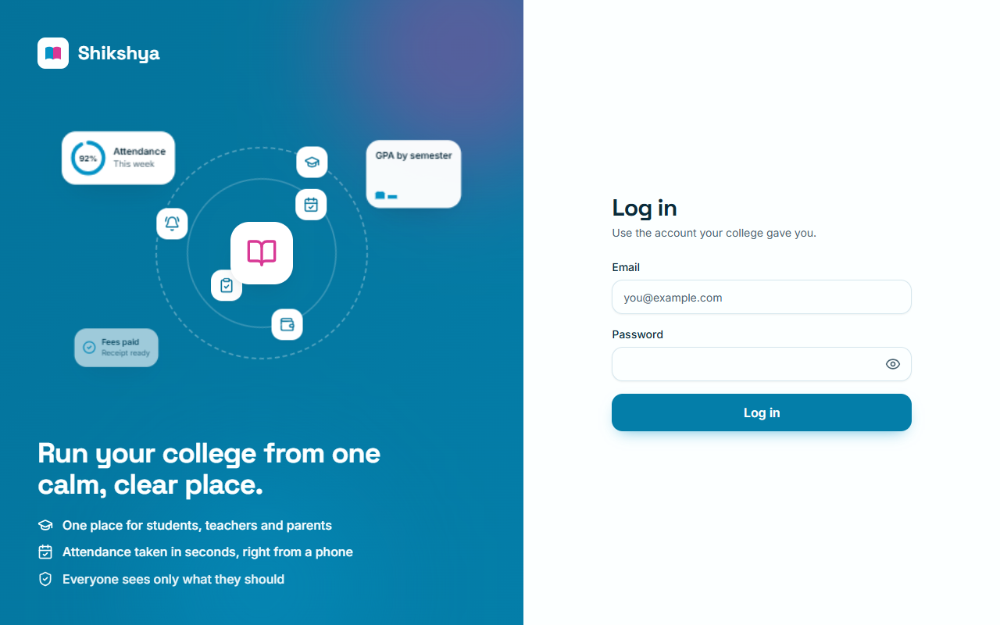

### Getting around

- **Menu:** on a computer it is down the left. On a phone there is a bar along the bottom with your four main places, and **More** opens everything else.
- **Search:** press `Ctrl K`, or use the box at the top, to reach any page you can open.
- **Notifications:** the bell at the top rings when something new arrives. Choose which ones you get under **Notification settings**.
- **Assistant:** the sparkle button at the bottom right answers questions about your own records and the college rules. It can be wrong, so check anything important.
- **Your password:** open the menu under your name, then **Change password**.

## Students

### Your dashboard

Your day at a glance: today's classes, what is due soon, your latest result and attendance.

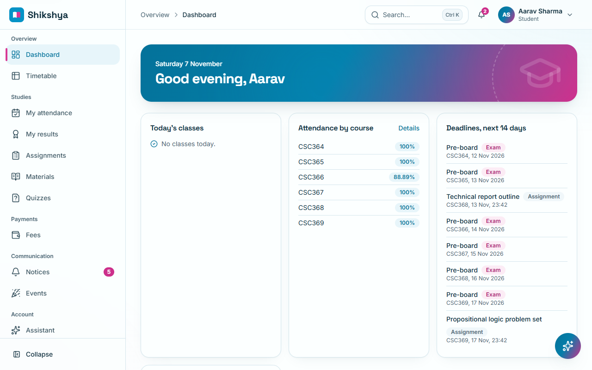

### Timetable

**Timetable** shows your week, with the room and teacher for each class.

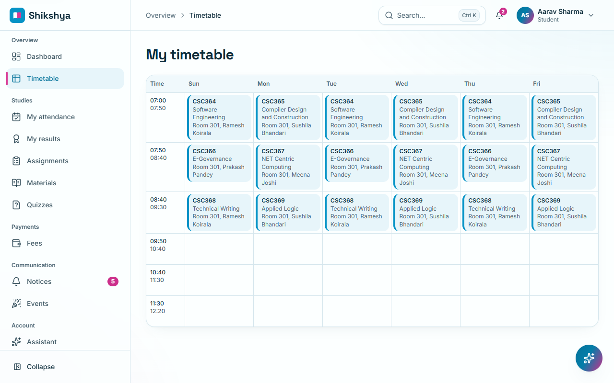

### Attendance

**My attendance** shows your percentage in each course. Below 75% is flagged in the app, and you and your parents are told when you fall below it.

Your percentage is the classes you attended, counting late, out of all classes held. Excused classes are not counted at all.

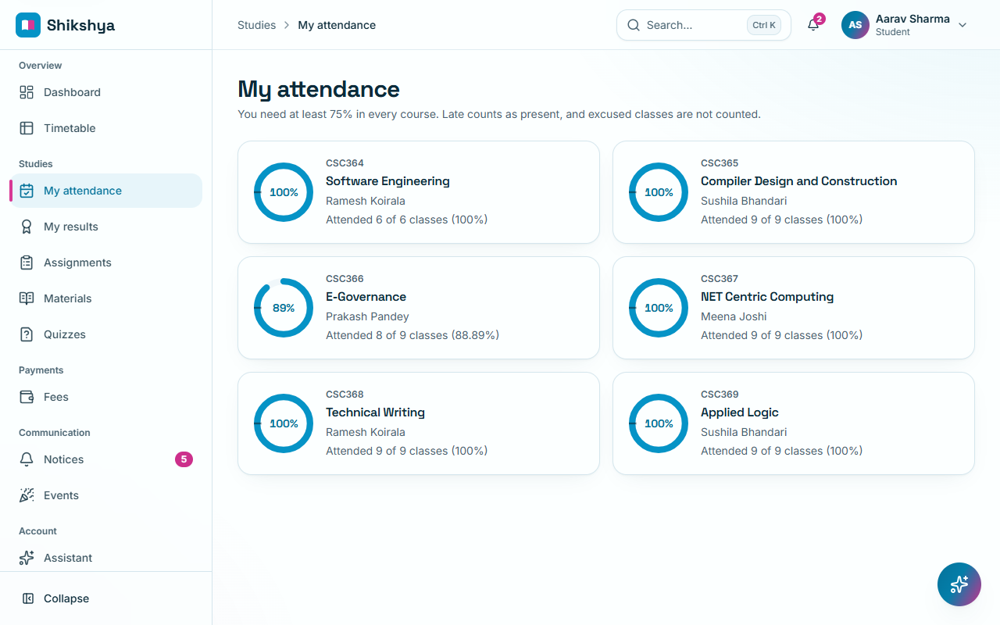

### Results

**My results** shows your GPA and grades for each semester, once the college publishes them, along with your CGPA. You can download a **Marksheet** for any semester, your **Transcript** and your **ID card** as PDFs.

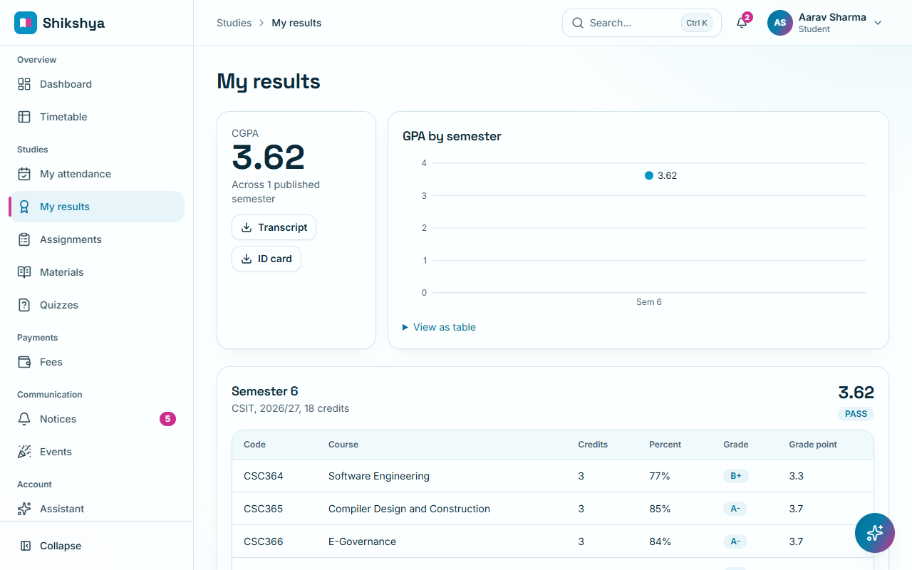

### Assignments and materials

**Assignments** lists what is due. Open one to hand in files or text. Pay attention to the deadline, because some teachers do not accept late work, and you cannot resubmit after the deadline. **Materials** holds files your teachers have shared.

### Quizzes

**Quizzes** shows what your teachers have set. Answer the questions and press **Submit answers**. You can only submit once, and you can see the correct answers after the quiz closes. Short answers wait for your teacher to mark them.

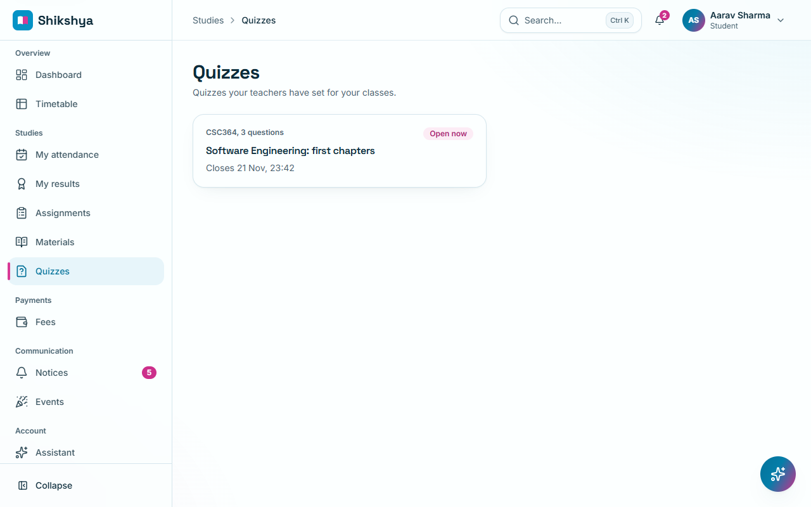

### Paying fees

1. Open **Fees** to see your invoices and what is still owed.
2. Press **Pay now** on an invoice, and choose eSewa or Khalti.
3. Pay on that service's own page. You will come back here afterwards.
4. Once it is confirmed, you can download your receipt.

If you close the page before coming back, do not pay again. The system checks with the payment service by itself, and your receipt will appear within about 15 minutes.

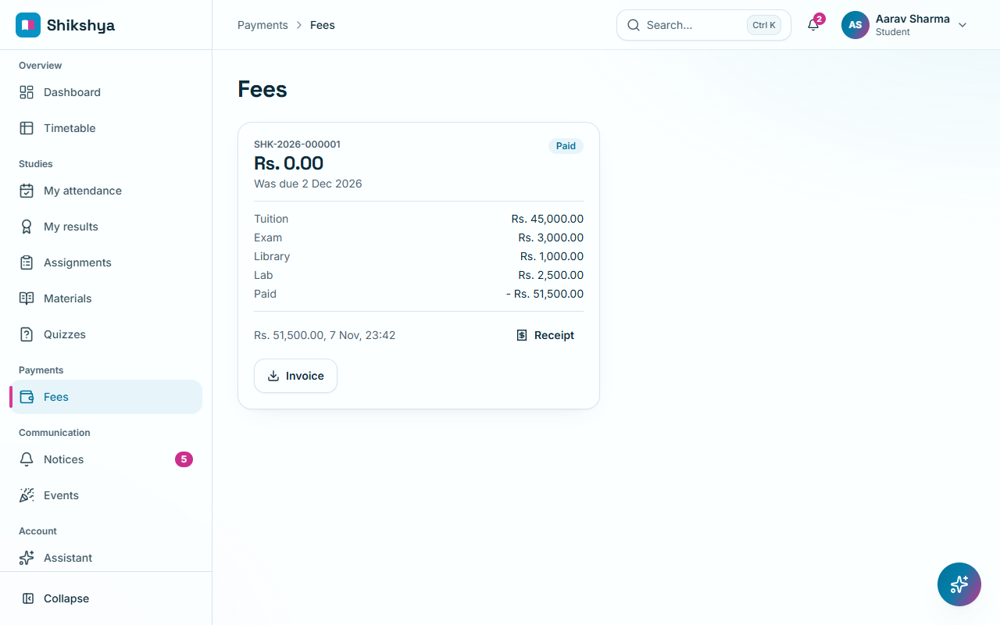

### Asking the assistant

Ask in plain English, such as "What is my attendance like?", "What's due in the next two weeks?", "How much do I owe?" or "How many days late can I pay my fees?". It answers from your own records and the college rules, and shows what it checked above the answer. It cannot see anyone else's records, and it will say "I don't know" about anything else.

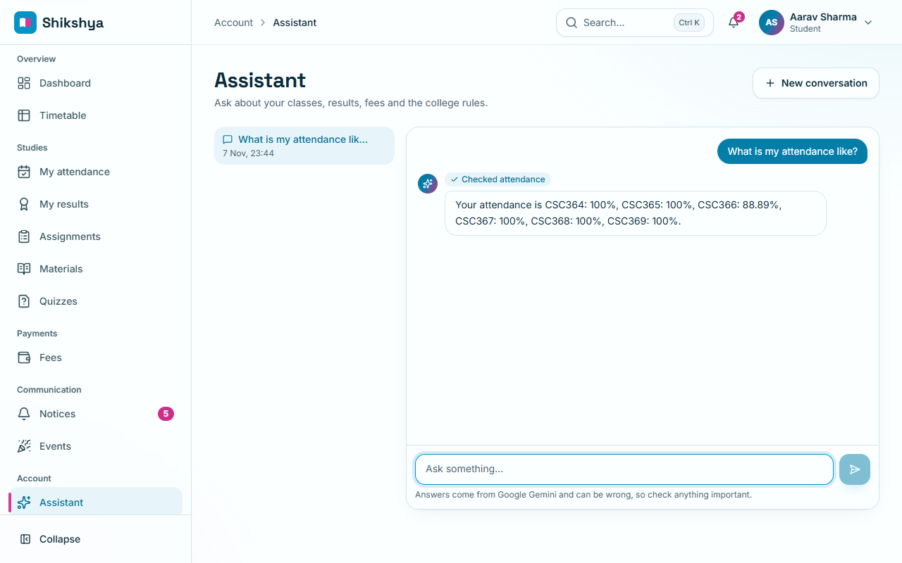

## Parents

Your account is linked to your children by the college. If you have more than one, choose a child at the top of each page.

You can see each child's timetable, attendance, results, assignments, materials and fees, and you get notifications about them, including when attendance falls below 75%.

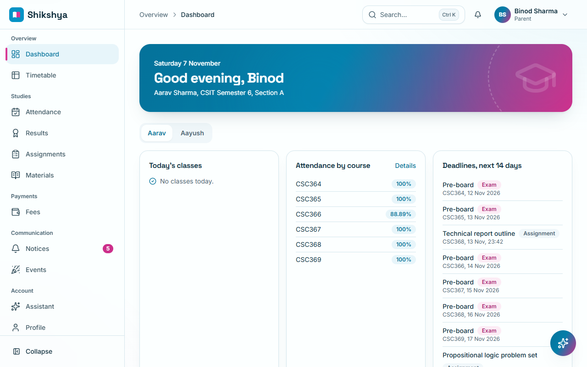

To pay, open **Fees** and follow the same steps as for students.

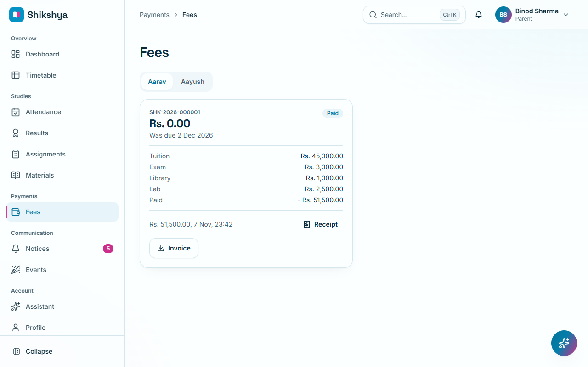

The assistant works for parents too. Ask "How is Aarav's attendance?", using your child's first name. If you have two children and do not say which, it will ask.

## Teachers

### Your dashboard

Today's classes, attendance you have not taken yet, work waiting to be graded, and students with low attendance.

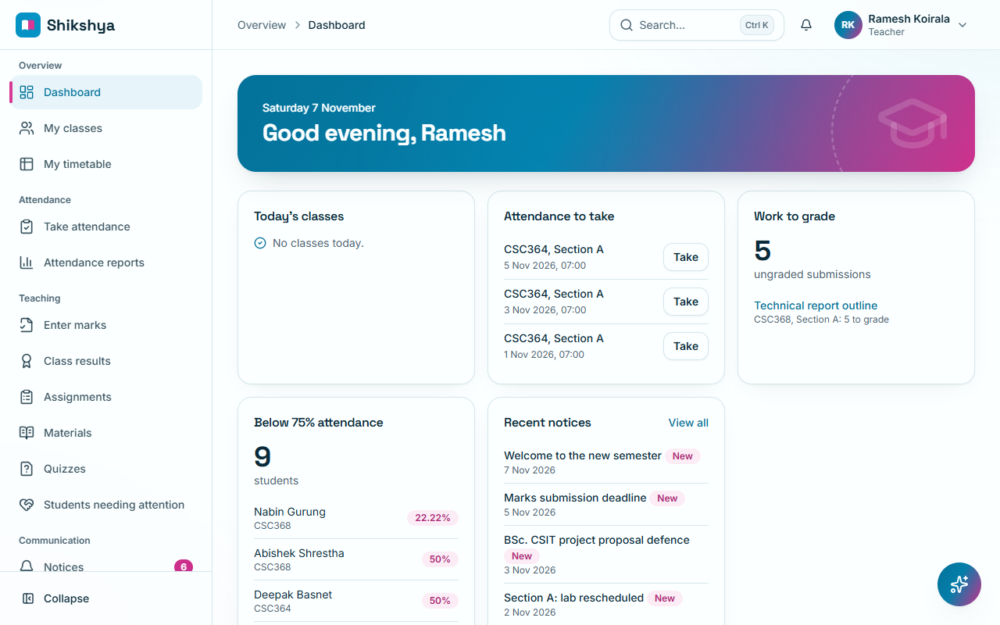

### Taking attendance

1. Open **Take attendance**.
2. Choose the class. The date is today, and you can set a period.
3. Everyone starts as Present. Tap anyone who is Absent, Late or Excused.
4. Press **Save**.

You can change a session for 48 hours after taking it. After that, ask an administrator. It is made to work one-handed on a phone.

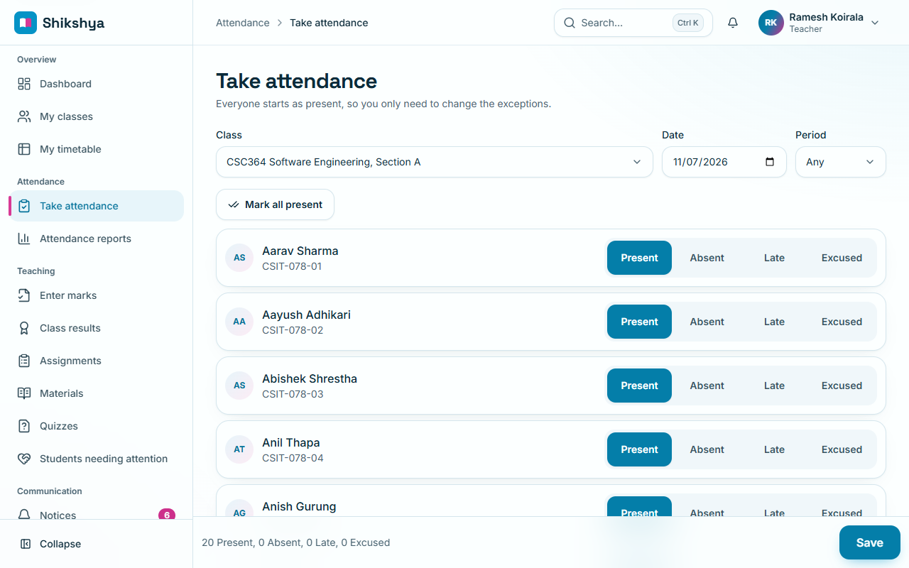

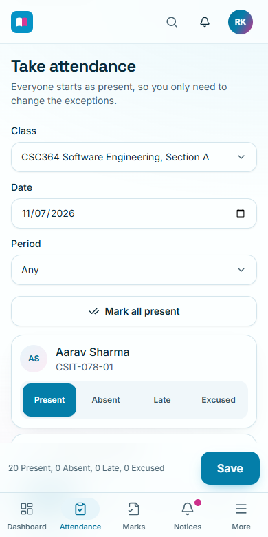

### Entering marks

Open **Enter marks** and choose a paper. Type each student's marks, or mark them absent. Each one saves by itself, with a tick to show it has. Once an administrator publishes the exam, marks are locked.

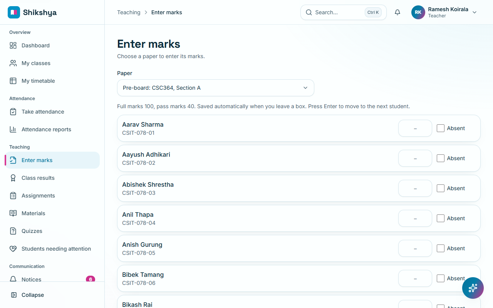

### Assignments and materials

Under **Assignments**, create one for a class, with a due date, marks and whether late work is accepted. Open it to see submissions, download the files and give marks and feedback. **Materials** is for sharing files with a class. Uploads can be up to 10 MB each, as PDF, Word, PowerPoint, ZIP or images.

### Students needing attention

This lists students in your classes who may be at risk of failing, with the reasons, such as low attendance or missing work. It is a prompt to check on someone, not a verdict, and it can be wrong. Students never see it. After talking to someone, press **Mark as reviewed** and note what was done.

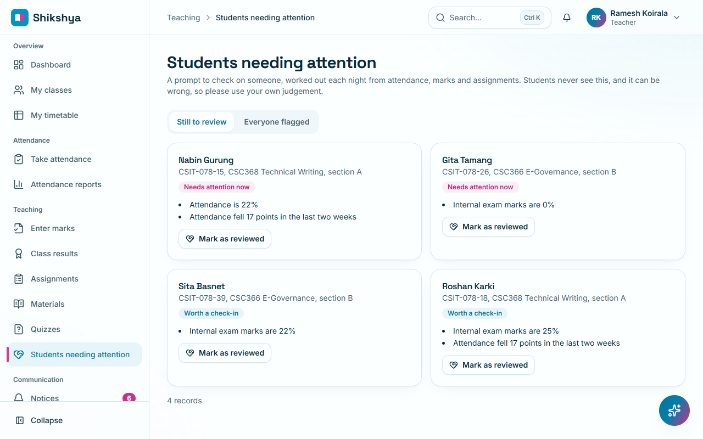

### Making a quiz with AI

1. Open **Quizzes**, then **Write a quiz with AI**.
2. Paste your notes or upload a PDF, and choose how many questions and what kind.
3. Check each question. It shows the answer, why, and the sentence from your notes it came from. Edit, regenerate or delete any of them.
4. Approve every question, and then **Publish**, with the times it opens and closes. Nothing reaches students until you do.

After it closes, open it to mark short answers.

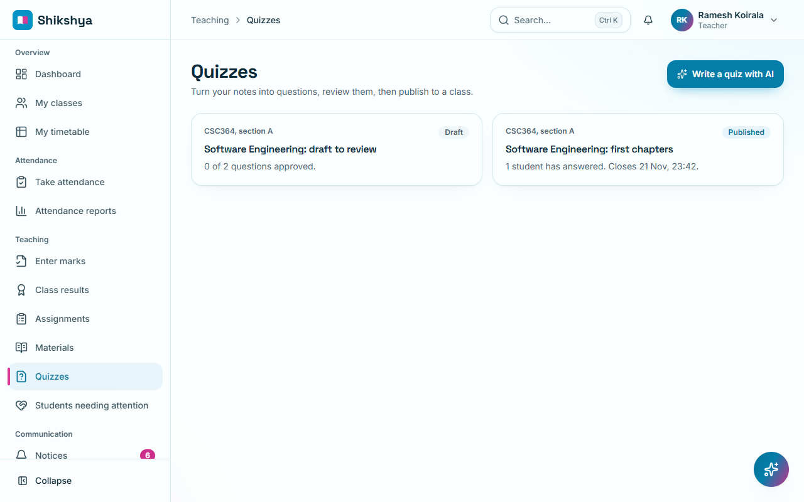

## Accounts office

Your dashboard shows what has been collected today and this month, what is outstanding by program, and the last 30 days.

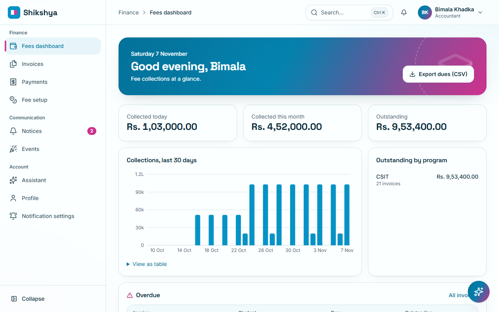

### Setting up fees

Under **Fee setup**, create fee heads such as Tuition, then a fee structure for each program and semester, and fine rules. **The accounts office and administrators both have access here.**

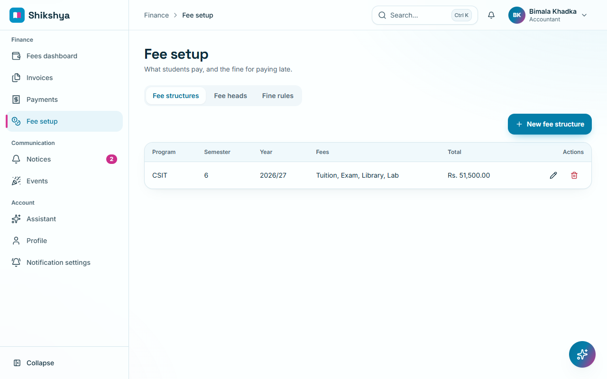

### Invoices

Under **Invoices**, generate them for a semester from its fee structure. Generating twice creates no duplicates, so it is safe to run again after adding students. You can give a discount, which needs a reason, or cancel an invoice with no payments. Fines are added by themselves each day after the due date.

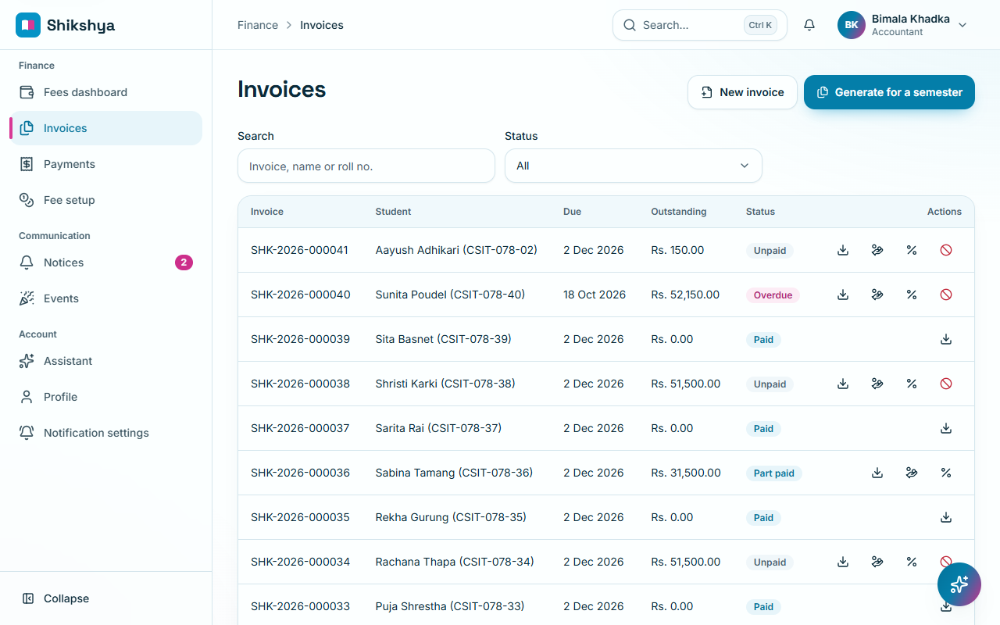

### Payments

Online payments appear by themselves under **Payments**. For cash or a bank transfer, find the invoice under **Invoices** and record the payment there, and a receipt is numbered automatically. The fees dashboard can export what is outstanding as a spreadsheet. Every change is recorded in the audit log.

## Administrators

### Your dashboard

Students by program, today's attendance, low attendance across the college, and upcoming exams.

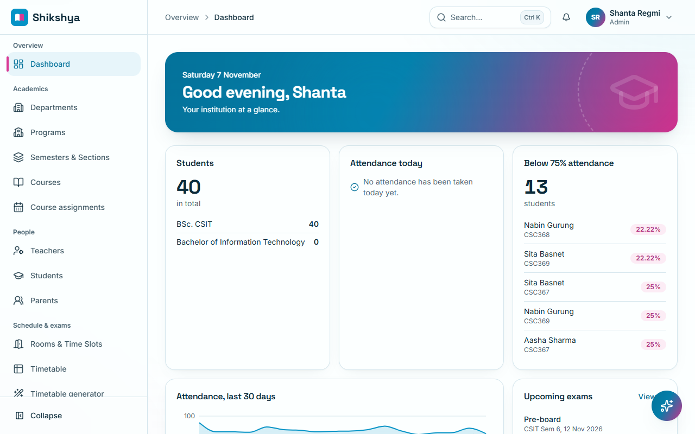

### Setting up the college

Work through the menu in this order, because each depends on the one before:

1. **Departments**, then **Programs**
2. **Semesters & Sections**, under the current academic year
3. **Courses**
4. **Teachers** and **Students**
5. **Course assignments**, which say who teaches which course to which section
6. **Rooms & Time Slots**, then the **Timetable**

New accounts get a temporary password, shown to you once, and must choose their own at first login.

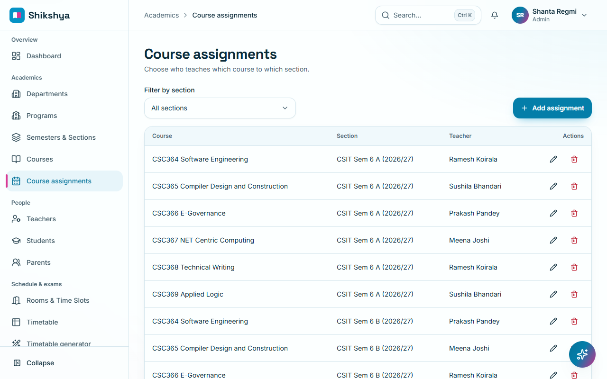

### Importing students

Under **Students**, choose **Import CSV**, which also offers a template. Every row is checked first, and if any row has a problem, nothing is imported and you are told which row and why.

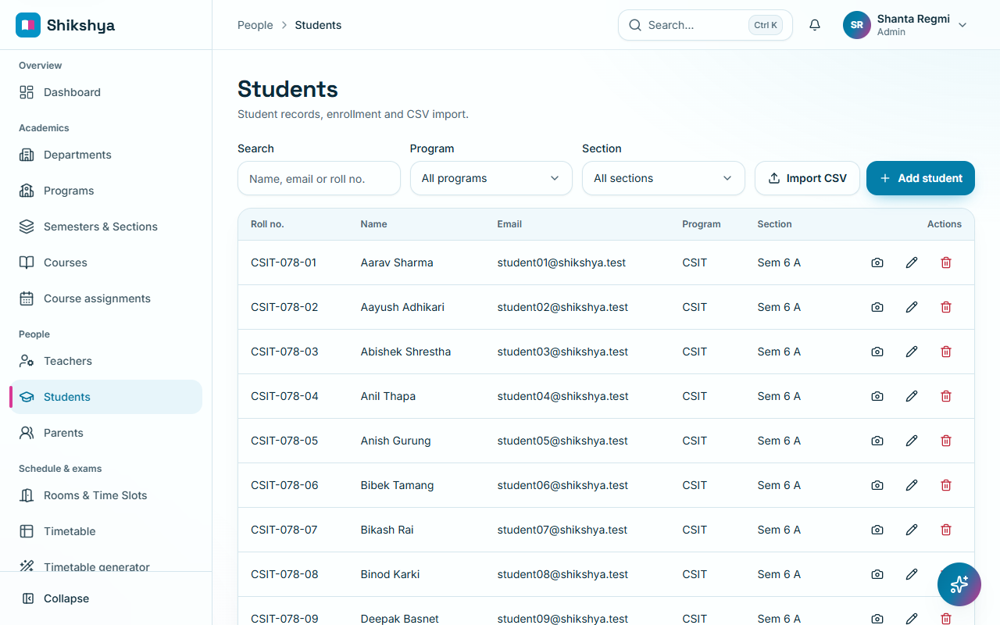

### Generating a timetable

1. Open **Timetable generator** and choose a semester.
2. Set how many theory and lab periods each class needs, and when any teacher is unavailable, using **Set**.
3. Press **Generate**. It takes a few seconds, and shows how many clashes there are, which should be none.
4. Press a class to move it. If that would cause a clash, you are warned, and **Save** turns off until it is fixed.
5. Press **Save**. This replaces the semester's timetable.

If the request is impossible, it explains why in plain words.

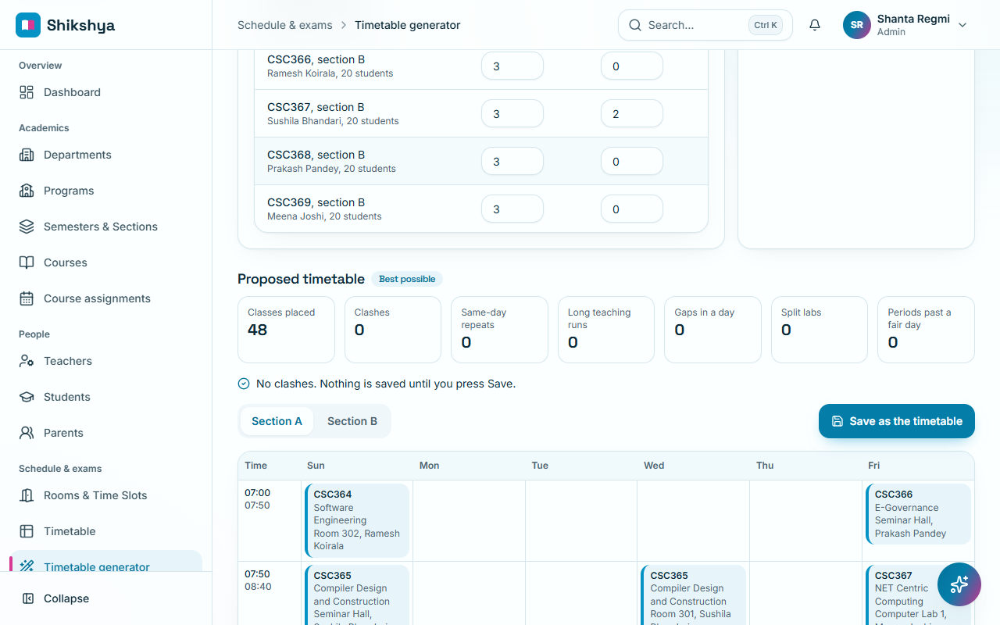

### Exams and results

Create an exam under **Exams**, and add a subject for each class. Once teachers have entered all the marks, press **Publish**. This locks the marks, works out everyone's GPA, and shows them to students and parents. Publishing is refused while any marks are missing. If you find a mistake, **Unlock** withdraws that exam from results until you publish it again. **Class results** shows how a section did.

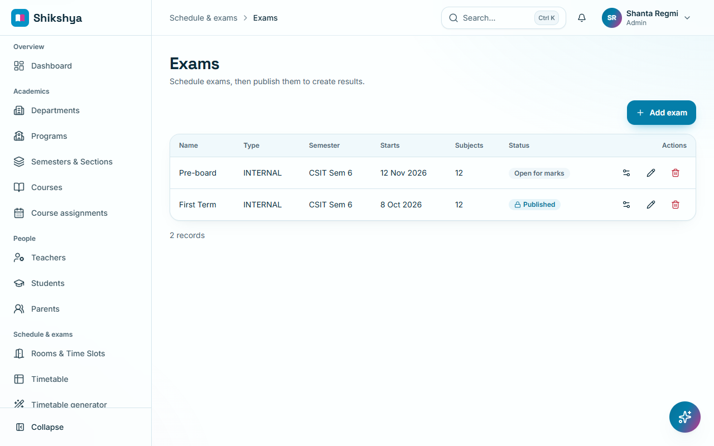

### College rules

Upload your rules as PDF or Word files, so the assistant can answer questions about them. Press **Prepare search** to let them be found by meaning, rather than only by matching words. It needs Gemini to be set up.

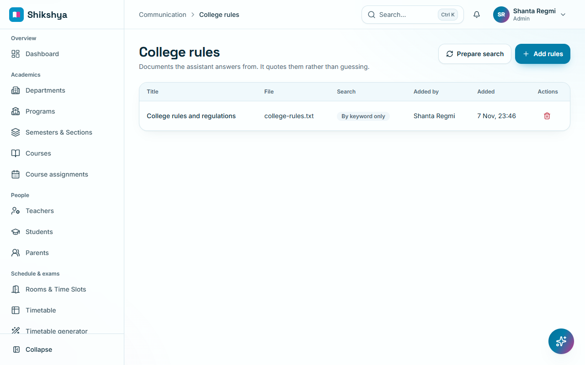

### Students needing attention

Press **Recalculate now** to update it, or wait for the nightly update. You see counts by section, and every flagged student. See [Teachers](#students-needing-attention) for what the list means.

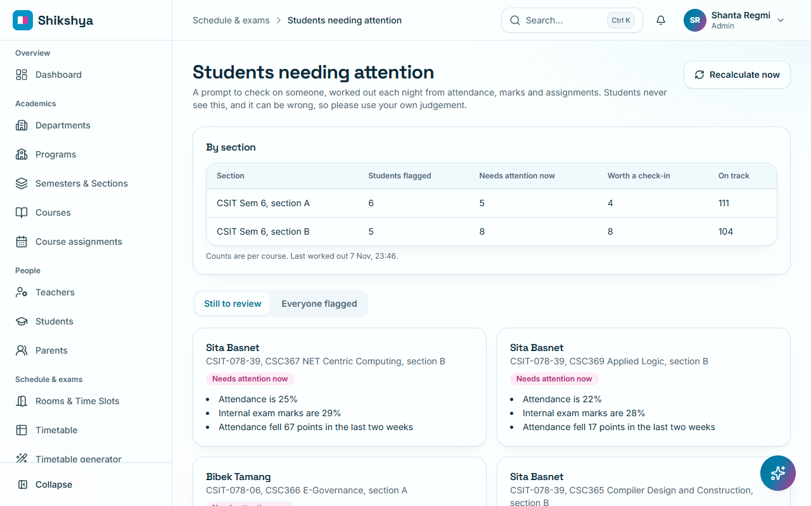

### Notices and events

**Notices** can go to everyone, or just to students, teachers, parents, a program or a section, now or at a chosen time. People are notified when one goes out. **Events** list college dates, for everyone or a chosen audience.

### Super admins

A super admin can do everything an administrator can. Only a super admin can change **Institution settings**: the college's name, address, contact details, principal's name and logo, which appear on PDFs.

## Librarians

Librarian accounts exist so a library module can be added later, but they have no screens of their own yet. You can log in, read notices and events, use the assistant, and change your password.
